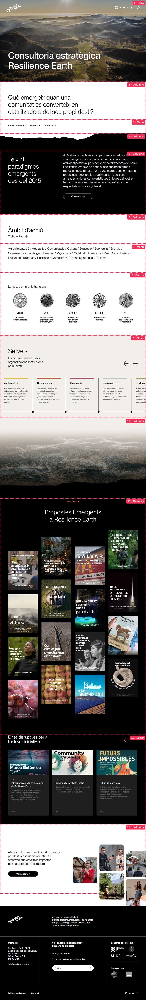
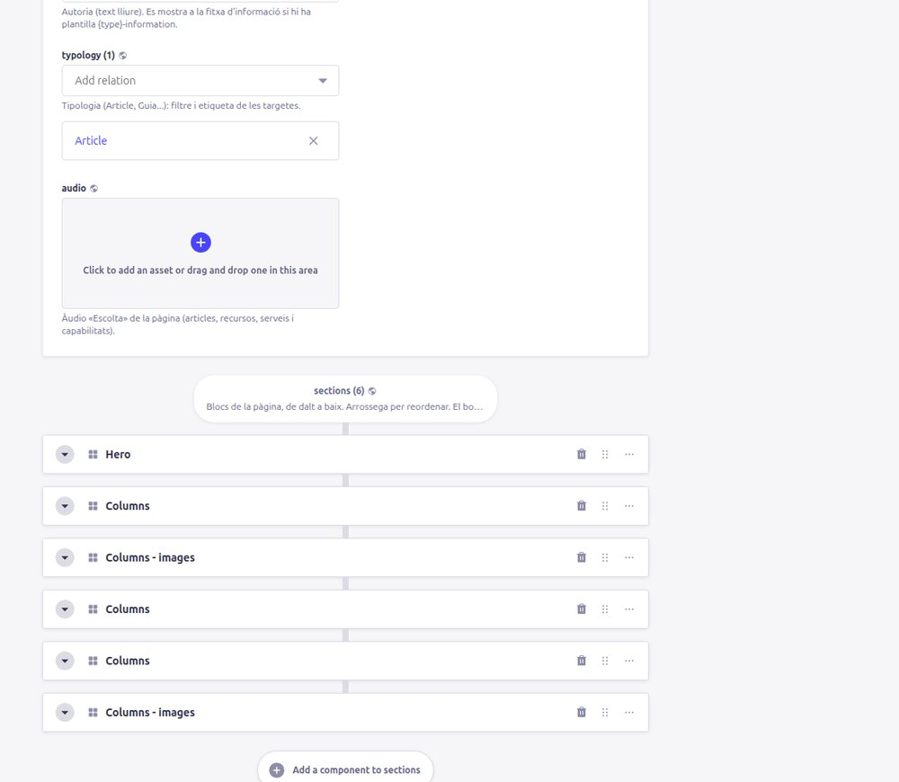
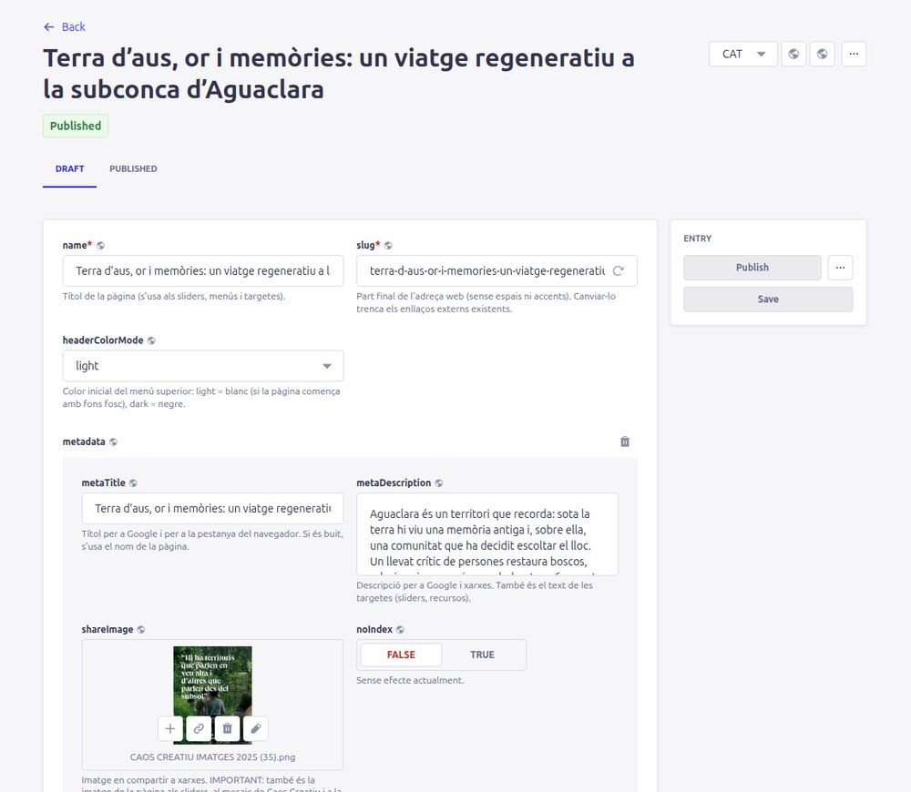

# 1. Com està muntada la web

[← Índex](README.md)

## 1. Les peces

La web té dues parts que funcionen juntes:

```
  ┌────────────────────────────┐        ┌──────────────────────────────┐
  │  ADMINISTRADOR (Strapi)    │        │  WEB PÚBLICA (resilience.earth)│
  │  api-w.resilience.earth/admin │ ──► │  Llegeix els continguts de    │
  │  Aquí s'escriuen textos,    │ dades  │  Strapi i els pinta amb el    │
  │  imatges, pàgines i menús   │        │  disseny de la web            │
  └────────────────────────────┘        └──────────────────────────────┘
```

- **Strapi** és on treballes tu: és com una base de dades amb formularis.
- **La web pública** agafa aquestes dades i les mostra amb el disseny. El disseny (tipus de lletra, animacions, com es veu un slider...) està programat i no es pot canviar des de Strapi. Des de Strapi decideixes **què** es mostra i, fins a cert punt, **com es col·loca** (amplades, colors, espais).

Els canvis que fas a Strapi es veuen a la web **en uns segons**, recarregant la pàgina. No cal fer res més.

## 2. Una pàgina és una pila de blocs

Cada pàgina de la web és una llista de **blocs** (a Strapi es diuen *sections* o *components*) posats un sota l'altre. Per exemple, la Home està feta amb 13 blocs:



*Cada requadre vermell és un bloc. L'etiqueta diu el número i el tipus de bloc (Hero, Columns, Menu, Slider...).*

Hi ha uns quants **tipus de bloc**. Els més usats són:

| Bloc | Per a què serveix |
|---|---|
| **Hero** | La capçalera gran de la pàgina, amb títol i imatge o vídeo de fons. |
| **Columns** | El bloc «per a tot»: text, imatges i botons repartits en una o diverses columnes. |
| **Slider** | Un carrusel de targetes (articles, recursos, serveis...). |
| **Menu** | Una llista d'enllaços (com a índex, núvol de paraules o cinta de logos). |
| **Masonry** | El mosaic d'imatges de Caos Creatiu (tots els articles). |
| **Blog** | La llista de recursos d'Eines disruptives. |
| **Template** | Insereix un grup de blocs compartit (una *plantilla*). |

Tots els blocs s'expliquen a [Blocs](04-blocs.md).

Dins de l'administrador, els blocs d'una pàgina es veuen així (a baix de tot del formulari de la pàgina):



## 3. Tipus de pàgina i adreces

Totes les pàgines són del mateix tipus de contingut (**Page**), però tenen un camp **type** que decideix l'adreça i on surten:

| type | Adreça en català | Per a què | On apareix automàticament |
|---|---|---|---|
| `page` | `/nom-de-la-pagina` | Pàgines generals (Home, Qui som, Contacte...) | — |
| `article` | `/article/nom` | Articles de **Caos Creatiu** | Mosaic de [Caos Creatiu](https://resilience.earth/caos-creatiu) i de la Home |
| `resource` | `/recurs/nom` | Recursos d'**Eines disruptives** | Llista de [Eines disruptives](https://resilience.earth/eines-disruptives) |
| `scope` | `/ambit/nom` | Àmbits d'acció (Agroalimentació, Cultura...) | — |
| `service` | `/servei/nom` | Serveis | — |
| `capability` | `/capabilitat/nom` | Capabilitats | — |

- En castellà i anglès l'adreça porta davant `/es/` o `/en/` (i el prefix traduït: `/es/articulo/...`, `/en/resource/...`).
- El **slug** és l'última part de l'adreça (`/article/`**`el-meu-article`**). Sense espais, sense accents, en minúscules i amb guions.
- ⚠️ Canviar el `type` o el `slug` d'una pàgina publicada **canvia la seva adreça**: els enllaços que la gent tingui guardats deixaran de funcionar.

## 4. La «imatge de compartir» és molt important

Cada pàgina té un apartat **metadata** amb:

- `metaTitle`: el títol que surt a Google i a la pestanya del navegador.
- `metaDescription`: la descripció per a Google i xarxes socials.
- `metaDescriptionShort`: descripció curta.
- `shareImage`: la imatge que surt en compartir l'enllaç a xarxes.

**Però a més**, aquesta informació és la que fan servir les **targetes** que enllacen a la pàgina:

- Al **mosaic de Caos Creatiu** només es veu la `shareImage` de cada article.
- Als **sliders** (carrusels) es veu la `shareImage`, el nom (`name`), la `metaDescriptionShort` i la tipologia.
- A la **llista d'Eines disruptives** es veu la `shareImage`, el nom, la tipologia, l'any i la descripció.

Per tant: **un article o recurs sense `shareImage` es veurà buit** a les llistes.

## 5. Esborrany (*Draft*) i publicat (*Published*)

Només les **pàgines** (i les Bios) tenen esborrany. **Menús, plantilles, Header, Footer, Text i la resta no en tenen**: només hi ha el botó **Save**, i en desar el canvi ja és a la web.

Strapi guarda dues versions de cada pàgina:

- **Draft (esborrany)**: la versió en què estàs treballant. El botó **Save** desa aquesta versió.
- **Published (publicada)**: la versió que es considera «pública». El botó **Publish** copia l'esborrany a la versió publicada.



La web pública mostra **sempre la versió publicada**. Per tant pots fer *Save* tantes vegades com vulguis mentre treballes: res no canvia a la web fins que prems **Publish**. La columna *Status* de la llista indica *Modified* quan una pàgina té canvis desats sense publicar.

> Les llistes automàtiques (el mosaic de **Caos Creatiu**, la llista d'**Eines disruptives** i els seus filtres) també mostren només pàgines **publicades**.

La norma senzilla és: **quan acabis un canvi en una pàgina, prem *Save* i després *Publish***. En un menú o una plantilla, *Save* ja ho publica (no hi ha esborrany).

El mateix passa amb les **Bios**: una persona sense publicar no surt a les pàgines (ni a les llistes d'equip).

## 6. Idiomes

La web està en **català** (idioma principal), **castellà** i **anglès**. A Strapi, cada pàgina, menú i plantilla té **una versió per idioma**, i cada versió s'edita per separat.


- El selector d'idioma és a dalt a la dreta de cada formulari (CAT / ESP / ENG).
- Si una pàgina no existeix en un idioma, en aquell idioma no es veu (ni surt a les llistes).
- Els **menús i sliders també són per idioma**: si afegeixes un article al slider en català, també l'has d'afegir a la versió castellana i anglesa del menú.

Com traduir: [Receptes › Traduir](03-receptes.md#g-traduir-una-pàgina).

## 7. Peces de contingut que no són pàgines

A la columna esquerra de l'administrador (*Content Manager*) hi ha altres tipus de contingut:

| Tipus | Per a què |
|---|---|
| **Menu** | Llistes d'elements. S'usen per als menús de la web **i també per als sliders, cintes de logos i núvols de paraules**. |
| **Template** | Plantilles: grups de blocs que es repeteixen a moltes pàgines. Vegeu [Plantilles](06-plantilles.md). |
| **Bio** | Fitxes de persones (equip). Tenen pàgina pròpia a `/bio/nom`. |
| **Capability** | Capabilitats (llista desplegable de la pàgina «Com treballem»). |
| **Scope**, **Tag**, **Typology**, **Year** | Llistes per classificar articles i recursos (s'usen als filtres). |
| **Header** | Logo, menú principal, xarxes socials, CSS global, codi de Google Tag Manager i textos del bàner de galetes. |
| **Footer** | Peu de pàgina. |
| **Text** | Textos fixos de la web: animació de la Home, etiquetes dels filtres, formulari de contacte... |
| **EmailConfig** | Correus automàtics del formulari de contacte i de la subscripció. |
| **Lead**, **Subscription** | Missatges rebuts pel formulari de contacte i subscripcions al butlletí (només lectura). |
| **EcosystemNode / EcosystemLink** | Dades del gràfic d'ecosistema (no s'usa actualment a cap pàgina). |

[Següent: Strapi bàsic →](02-strapi-basic.md)
