# 2. Strapi bàsic

[← Índex](README.md)

## 1. Entrar

Ves a **https://api-w.resilience.earth/admin** i entra amb el teu correu i contrasenya.

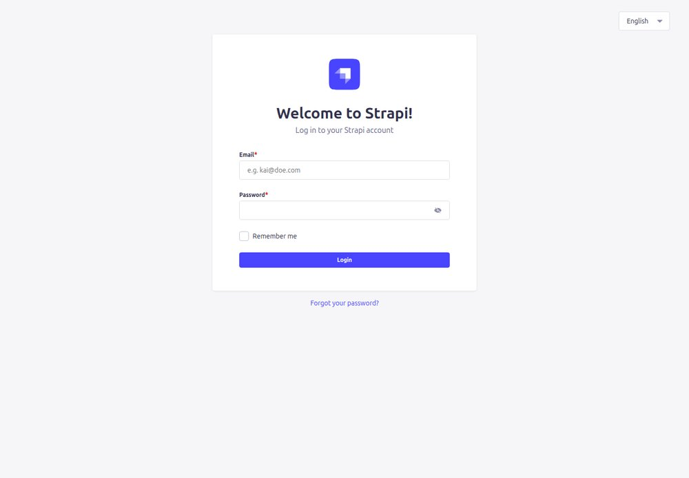

L'administrador està en anglès. Els noms dels camps també (`name`, `slug`, `title`...), però sota de cada camp hi ha una **explicació en català** del que fa.

## 2. El Content Manager

Tot el contingut es gestiona des del **Content Manager** (icona de la ploma, a la barra de l'esquerra). A la columna esquerra hi ha la llista de tipus de contingut:

- **Collection types**: tipus amb moltes entrades (Page, Menu, Template, Bio...).
- **Single types**: tipus amb una sola entrada (Header, Footer, Text, EmailConfig).

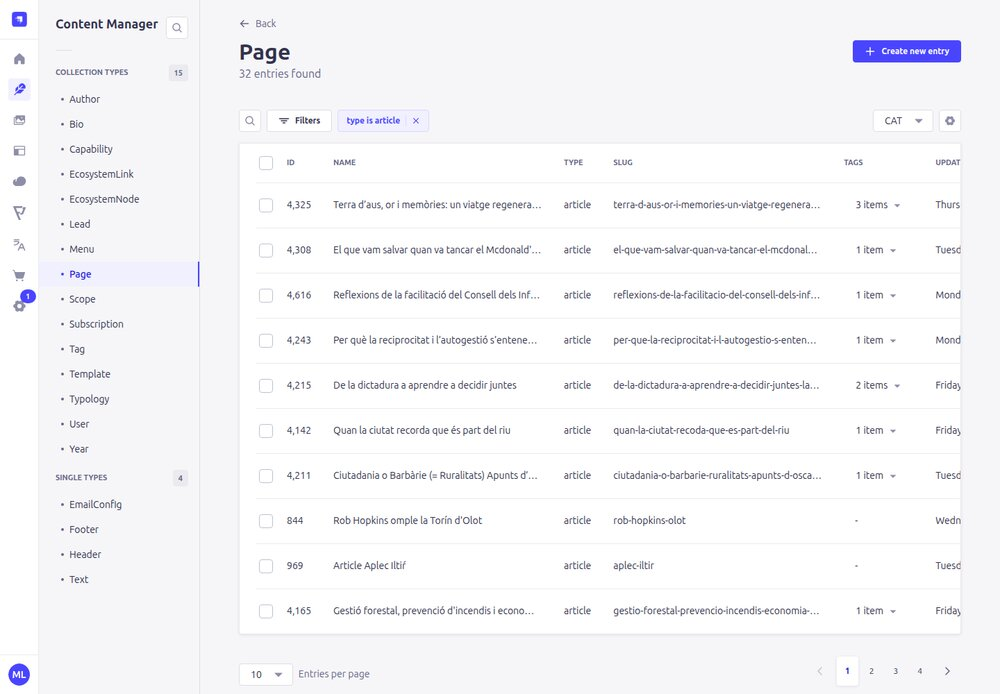

## 3. Trobar una pàgina

1. Clica **Page** a la columna esquerra.
2. Comprova l'**idioma** (desplegable `CAT` a dalt a la dreta de la llista).
3. Fes servir la **lupa** per buscar pel nom, o **Filters** per filtrar. El filtre més útil és **type**: `article` per veure només els articles de Caos Creatiu, `resource` per als recursos d'Eines disruptives.

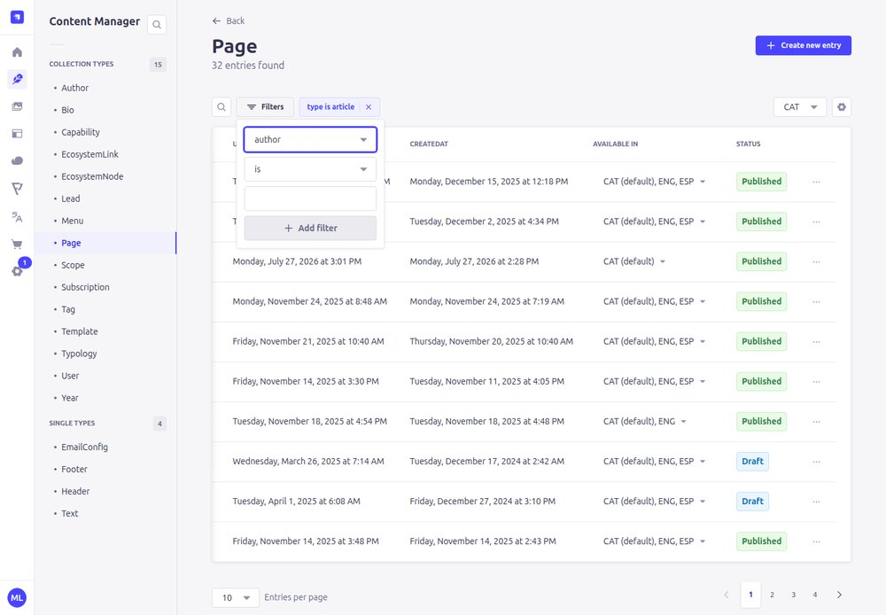

La columna **Status** indica si la pàgina està *Published* (publicada), *Draft* (mai publicada) o *Modified* (publicada però amb canvis desats sense publicar).

> Truc: la URL de la pàgina a la web et diu el *slug*. Per exemple `resilience.earth/article/terra-d-aus...` → busca `terra-d-aus`.

## 4. El formulari d'una pàgina

En obrir una pàgina veuràs, de dalt a baix:

1. **Camps generals**: `name` (títol), `slug` (adreça), `headerColorMode`, `metadata` (títol i descripció per a Google, imatge de compartir), `type`, etiquetes, àmbits, any, tipologia, autoria, àudio...
2. **sections**: la llista de **blocs** de la pàgina.
3. `sortDate`: la data que ordena els articles a Caos Creatiu.
4. A la dreta, el requadre **Entry** amb els botons **Publish** i **Save**.

Veure el formulari sencer d'un article

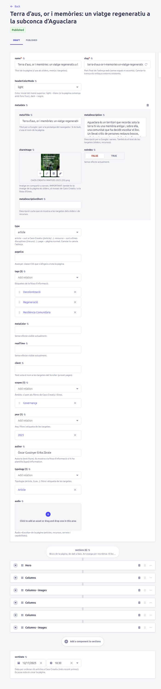

## 5. Editar una pàgina

### Canviar un text o una imatge

1. Baixa fins a **sections** i clica el bloc que vols canviar per desplegar-lo.

   

2. Edita els camps. Els textos llargs (`text`) són editors de text amb negreta, cursiva, títols, llistes i enllaços.

   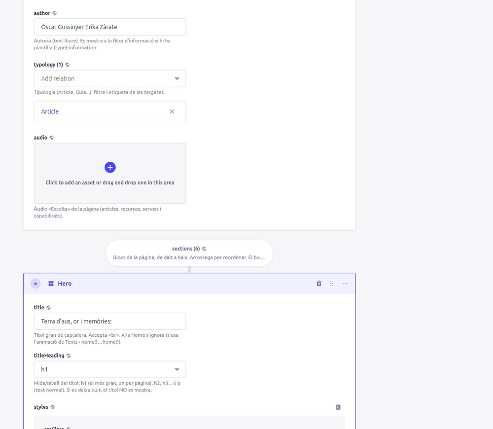

3. Per canviar una imatge, passa el ratolí per sobre de la imatge i fes servir les icones: **+** (afegir), **🔗** (copiar enllaç), **🗑** (treure) o **✏️** (editar). Clicant un requadre buit s'obre la **biblioteca d'imatges** on pots triar-ne una d'existent o pujar-ne una de nova.
4. Prem **Save** i, si és una pàgina, també **Publish**.

### Afegir un bloc

A sota de tots els blocs hi ha el botó **Add a component to sections**. Mostra els tipus de bloc disponibles:

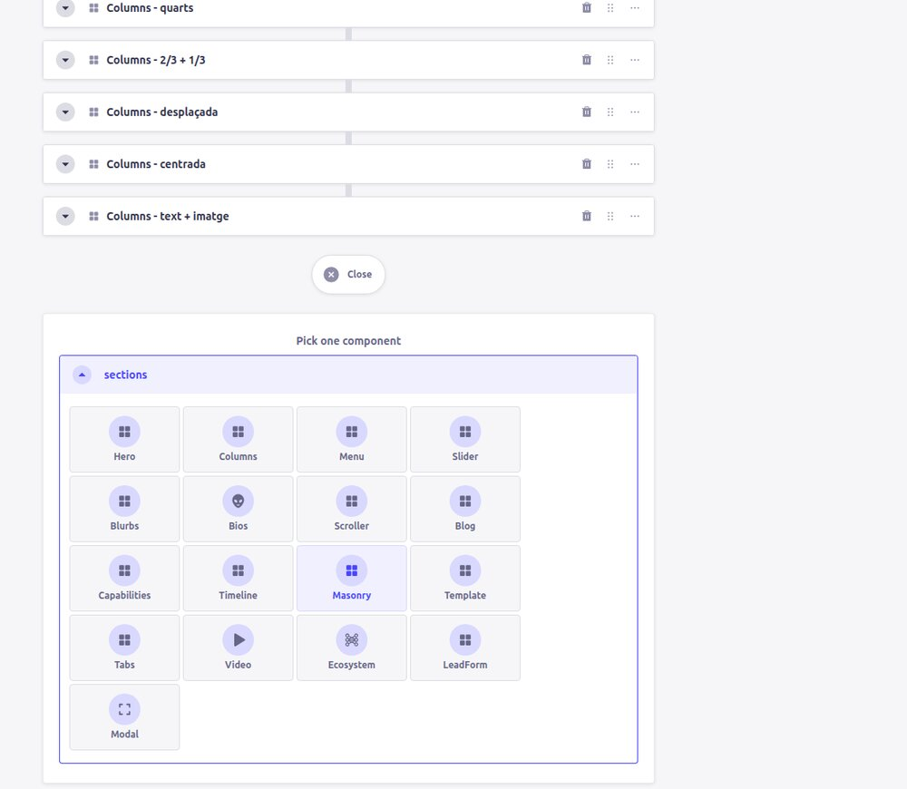

El bloc nou s'afegeix al final. Per moure'l, arrossega'l per la icona de **punts** (⋮⋮) a la dreta del bloc.

> ⚠️ Un bloc nou està buit i **sense estils**. Sovint és més fàcil **duplicar la pàgina** i treure el que sobra, o copiar a mà els valors d'estil d'un bloc semblant d'una altra pàgina (vegeu [Estils](05-estils.md)).

### Moure, inserir o esborrar un bloc

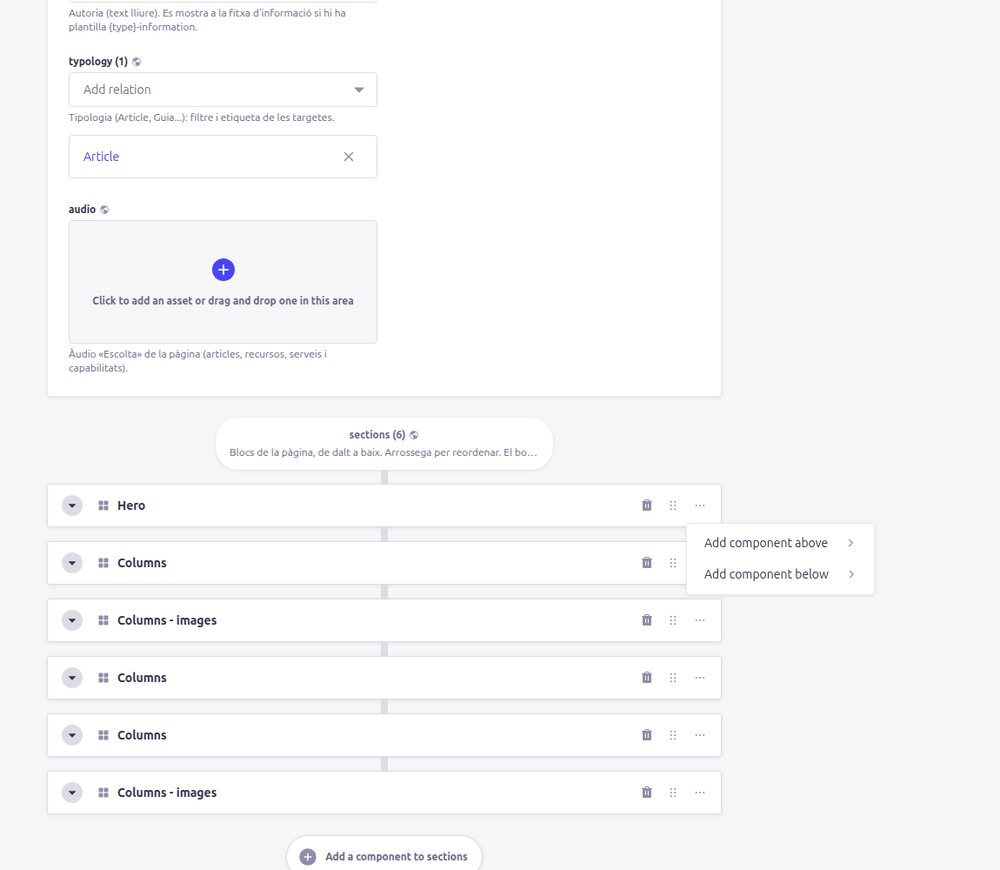

- **⋮⋮** (arrossegar): canviar l'ordre.
- **🗑**: esborrar el bloc.
- **…** (*More actions*): *Add component above* / *Add component below* (inserir un bloc nou just a sobre o a sota).

> Strapi no permet duplicar un sol bloc. Si necessites un bloc igual que un altre, la manera més ràpida és **duplicar tota la pàgina** (secció següent) o recrear-lo copiant els valors.

## 6. Desar i publicar

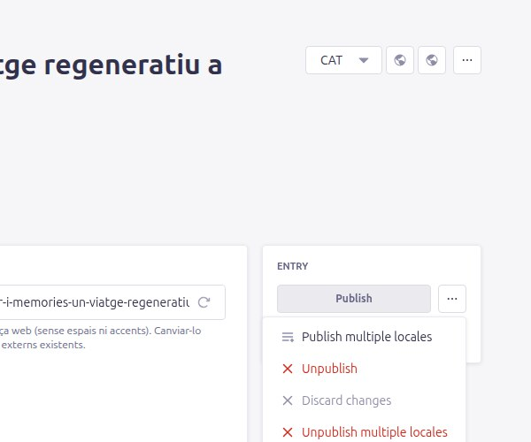

- **Save**: desa l'esborrany.
- **Publish**: publica. Una pàgina nova no surt a la web fins que es publica.
- El botó **…** al costat de *Publish* permet:
  - **Unpublish**: despublicar (la pàgina deixa de veure's).
  - **Discard changes**: descartar els canvis desats i tornar a la versió publicada.
  - *Publish/Unpublish multiple locales*: fer-ho per a diversos idiomes alhora.

Fins que no prems **Publish**, els canvis d'una pàgina no es veuen a la web ([Conceptes › Esborrany i publicat](01-conceptes.md#5-esborrany-draft-i-publicat-published)). Els menús i les plantilles no tenen esborrany: *Save* ja és immediat.

## 7. Duplicar una pàgina

És la manera més segura i ràpida de crear una pàgina nova: copia tots els blocs, estils, imatges i classificacions.

1. A la llista de pàgines, clica els **…** de la fila de la pàgina que vols copiar → **Duplicate**.

   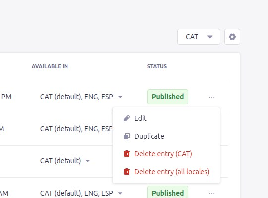

2. Strapi avisa que cal canviar el `slug` (no poden existir dues pàgines amb el mateix). Clica **Create**.

   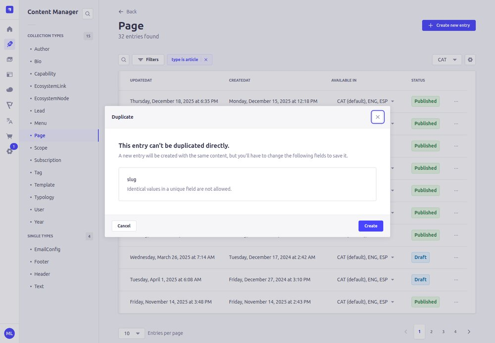

3. S'obre el formulari d'una pàgina nova amb tot copiat. **Canvia com a mínim**:
   - `name` (títol),
   - `slug` (clica la icona ⟳ per generar-lo a partir del títol),
   - `metadata` → `metaTitle`, `metaDescription`, `metaDescriptionShort`, `shareImage`,
   - `sortDate` → la data d'avui (si no, l'article sortirà a la posició de l'original a Caos Creatiu!),
   - els textos i imatges dels blocs.

   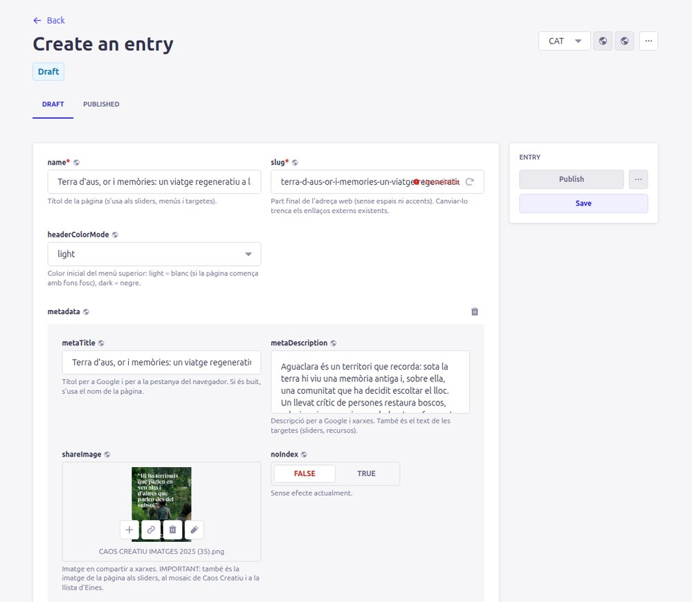

4. **Save** i, quan estigui llest, **Publish**.

> La duplicació copia **només l'idioma actual**. Les traduccions s'han de crear a part (vegeu [Traduir](03-receptes.md#g-traduir-una-pàgina)).

## 8. La biblioteca d'imatges (Media Library)

Icona de la imatge a la barra de l'esquerra. Aquí hi ha totes les imatges, vídeos, PDF i àudios.

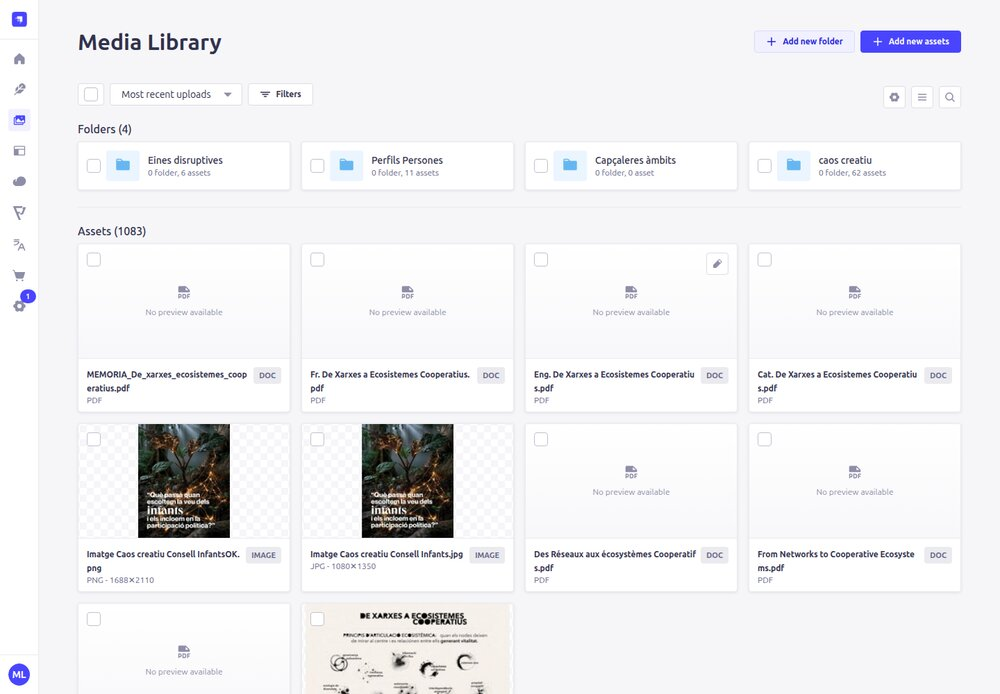

- **Add new assets** per pujar fitxers (arrossegant-los o des de l'ordinador).
- Posa noms de fitxer entenedors i omple el *Alternative text* (descripció per a persones cegues i per a Google).
- Mides recomanades:
  - **Imatge de compartir d'un article** (Caos Creatiu): **vertical 4:5**, 1080 × 1350 px. ⚠️ Al mosaic es retalla pels costats: deixa el text i les cares a un 15% de distància de les vores esquerra i dreta.
  - **Imatge de compartir d'un recurs** (Eines disruptives): **horitzontal 4:3**, 1024 × 768 px.
  - **Foto d'una persona (Bio, `mainImage`)**: retrat gairebé quadrat, en blanc i negre com les altres.
  - **Imatges de fons de capçalera (Hero)**: horitzontal, mínim 1920 px d'ample.
  - Pes: millor per sota de 500 KB (jpg o webp). Les imatges molt pesades fan la web lenta.
- **Vídeos de fons**: mp4, curts (10–30 s) i lleugers (< 10 MB). Es reprodueixen sense so i en bucle.
- **Abans d'esborrar** un fitxer, assegura't que no s'usa: si s'esborra, desapareix de totes les pàgines on surt.

## 9. Les ajudes sota cada camp

Cada camp té sota un text gris amb la seva funció. Per exemple, dins d'una columna:

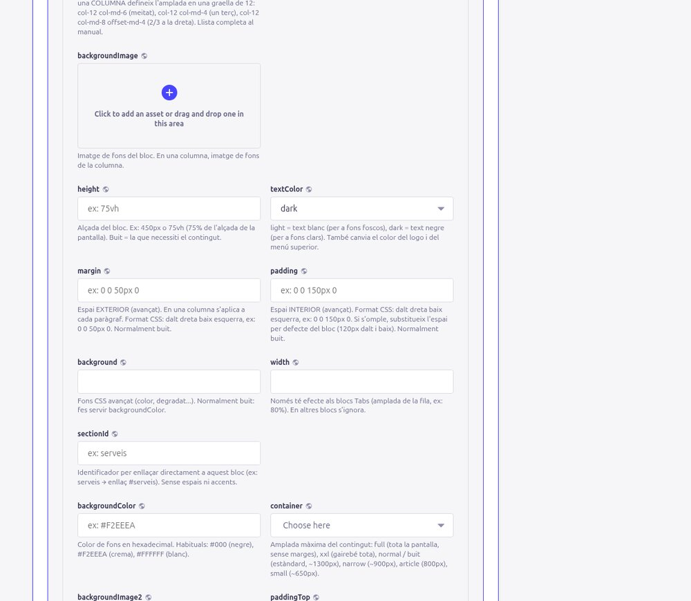

Si un camp diu **«Sense efecte»**, vol dir que existeix però la web no el fa servir: no cal omplir-lo.

[← Conceptes](01-conceptes.md) · [Següent: Receptes →](03-receptes.md)
