# 3. Receptes pas a pas

[← Índex](README.md)

- [A. Publicar un nou article a Caos Creatiu](#a-publicar-un-nou-article-a-caos-creatiu)
- [B. Publicar un nou recurs a Eines disruptives](#b-publicar-un-nou-recurs-a-eines-disruptives)
- [C. Afegir, treure o reordenar targetes d'un slider](#c-afegir-treure-o-reordenar-targetes-dun-slider)
- [D. Afegir una entrada a un menú](#d-afegir-una-entrada-a-un-menú)
- [E. Canviar els textos animats de la Home](#e-canviar-els-textos-animats-de-la-home)
- [F. Mostrar un avís emergent (modal)](#f-mostrar-un-avís-emergent-modal)
- [G. Traduir una pàgina](#g-traduir-una-pàgina)
- [H. Despublicar o esborrar](#h-despublicar-o-esborrar)
- [I. Crear una pàgina general nova](#i-crear-una-pàgina-general-nova)
- [J. Posar i treure persones de l'equip (Qui som)](#j-posar-i-treure-persones-de-lequip-qui-som)
- [K. Activar Google Analytics (Tag Manager) i el bàner de galetes](#k-activar-google-analytics-tag-manager-i-el-bàner-de-galetes)

---

## A. Publicar un nou article a Caos Creatiu

La pàgina [Caos Creatiu](https://resilience.earth/caos-creatiu) **no es construeix a mà**: el mosaic mostra **automàticament tots els articles publicats** (pàgines amb `type` = `article`), del més recent al més antic segons el camp `sortDate`. També surten al mosaic de la Home.

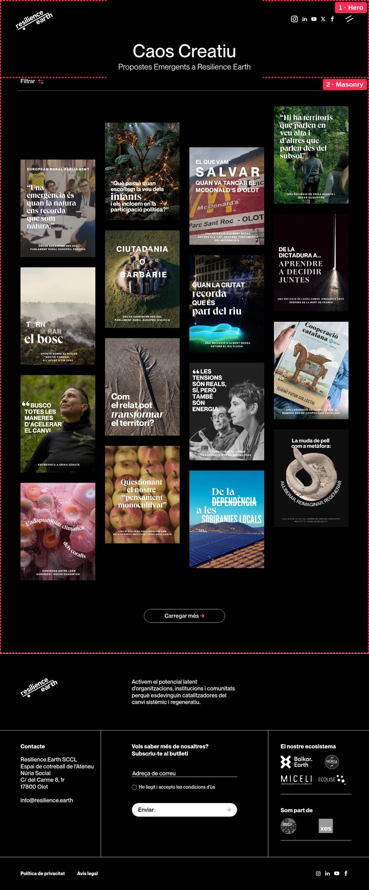

Per tant, publicar un article nou = **crear una pàgina de tipus article i publicar-la**.

### Com és un article per dins

Un article típic té aquests blocs ([exemple](https://resilience.earth/article/terra-d-aus-or-i-memories-un-viatge-regeneratiu-a-la-subconca-d-aguaclara)):

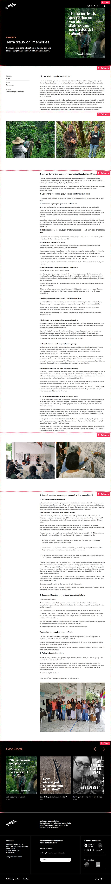

1. **Hero**: títol, subtítol i la imatge principal (a la dreta). La imatge es posa a `styles` → `backgroundImage`. Fons negre (`backgroundColor` `#000`) i text blanc (`textColor` `light`).
2. **Columns** amb el primer tros de text. ⚠️ **El 2n bloc ha de ser un Columns**: la web hi afegeix automàticament, a l'esquerra, la fitxa *Tipologia / Àmbits / Autoria* (vegeu [Plantilles](06-plantilles.md#3-plantilles-de-fitxa-dinformació)).
3. Més blocs **Columns** amb imatges i text, i opcionalment **Video**.
4. Al final, automàticament, el slider «Caos Creatiu» (plantilla `article`).

### Pas a pas

1. **Content Manager → Page**, idioma **CAT**, filtre `type` = `article`.
2. Tria un article recent que s'assembli al que vols fer → **… → Duplicate → Create** ([com duplicar](02-strapi-basic.md#7-duplicar-una-pàgina)).
3. Omple els camps generals:

   | Camp | Què posar |
   |---|---|
   | `name` | Títol de l'article. |
   | `slug` | Clica ⟳ per generar-lo del títol. Revisa que sigui curt i sense accents. |
   | `headerColorMode` | `light` (l'article comença amb fons negre). |
   | `metadata → metaTitle` | Títol per a Google (pot ser el mateix). |
   | `metadata → metaDescription` | 2–3 frases de resum. |
   | `metadata → metaDescriptionShort` | 1 frase curta: surt a les targetes dels sliders. |
   | `metadata → shareImage` | **La imatge del mosaic.** Vertical 4:5 (1080 × 1350 px). |
   | `type` | `article` (ja ve copiat). |
   | `typology` | Normalment *Article* (o Entrevista, Crònica...). Surt als filtres. |
   | `year` | Any. Surt als filtres. |
   | `scopes` | Àmbits relacionats. Surten als filtres i a la fitxa. |
   | `tags` | Etiquetes (opcional). |
   | `author` | Autoria, tal com vols que surti a la fitxa. |
   | `audio` | Opcional: versió en àudio. Surt un botó «Escolta» sota el títol. |
   | `sortDate` | **Data d'avui** (o la data que vulguis que ordeni l'article). |

4. Canvia els **blocs**:
   - **Hero**: `title`, `text` (subtítol) i `styles → backgroundImage` (imatge de la dreta).
   - **Columns**: substitueix els textos i imatges. Per esborrar un bloc que sobra, 🗑. Per afegir-ne, *Add a component to sections* o *… → Add component below*.
   - Mantén els estils (`styles`) tal com venen de l'original: així l'article es veurà igual que els altres.
5. **Save**. Revisa que no hi hagi errors (camps en vermell).
6. **Publish**.
7. Obre https://resilience.earth/caos-creatiu i comprova que l'article surt el primer del mosaic. L'adreça de l'article serà `https://resilience.earth/article/<slug>`.
8. *(Opcional)* Afegeix-lo al **slider «Caos Creatiu»** que surt al final de cada article, a Eines disruptives i a les capabilitats: [recepta C](#c-afegir-treure-o-reordenar-targetes-dun-slider), menú **Caos Creatiu**.
9. *(Opcional)* Tradueix-lo: [recepta G](#g-traduir-una-pàgina). Si no el tradueixes, no sortirà a les versions castellana i anglesa de Caos Creatiu.

> **Truc per al text.** A l'editor de text, un paràgraf que només contingui `
` fa una línia separadora, i pots escriure `<cite>text</cite>` per a la lletra serif cursiva dels subtítols. Més trucs a [Estils › Text](05-estils.md#8-trucs-dins-del-text).

---

## B. Publicar un nou recurs a Eines disruptives

Com Caos Creatiu, la pàgina [Eines disruptives](https://resilience.earth/eines-disruptives) mostra **automàticament tots els recursos publicats** (pàgines amb `type` = `resource`).

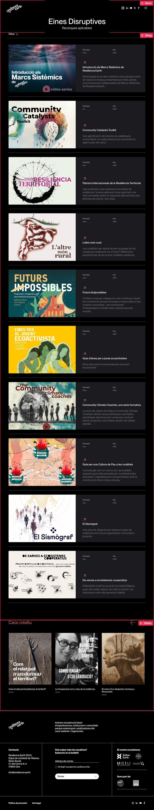

L'ordre el decideix el camp **`sortDate`** de cada recurs (el més recent primer), igual que a Caos Creatiu. Un recurs nou agafa la data del dia i surt a dalt; per moure'n un, canvia-li el `sortDate`.

### Com és un recurs per dins

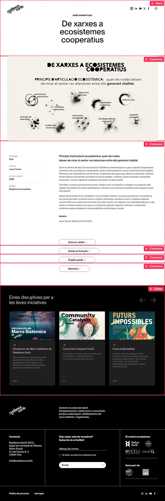

1. **Hero** amb el títol, centrat.
2. **Columns** amb una imatge gran (`container` `xxl`).
3. **Columns** amb el contingut i botons de descàrrega. ⚠️ **El 3r bloc ha de ser un Columns**: la web hi afegeix la fitxa *Tipologia / Àmbits / Autoria* a l'esquerra i el botó «Escolta» si hi ha àudio.
4. Més blocs opcionals (altres idiomes del document, galeria...).
5. Automàticament al final: slider «Eines disruptives» (plantilla `resource`).

### Pas a pas

Igual que l'[article](#pas-a-pas), amb aquestes diferències:

- Filtra la llista per `type` = `resource` i duplica un recurs.
- `shareImage`: **horitzontal 4:3** (1024 × 768 px).
- `metaDescriptionShort` i `metaDescription`: la llista d'Eines mostra la curta i, si és buida, la llarga.
- Els botons de descàrrega van a la columna del 3r bloc: el primer al camp **c2a** i la resta al camp **buttons** (una llista: **Add an entry** per cada botó, i es reordenen arrossegant). Cada botó té `text` (text del botó) i `href` (enllaç al PDF). Per enllaçar un PDF: puja'l a la Media Library, copia'n l'enllaç (icona 🔗) i enganxa'l a `href`. Posa `target` = `_blank` perquè s'obri en una pestanya nova.
  Abans calia un bloc Columns per cada botó (com a la imatge de dalt); aquests recursos continuen funcionant igual, no cal canviar-los.
- *(Opcional)* Afegeix-lo al slider **«Recursos per catalitzar les teves iniciatives»** (surt a la Home, al final de cada recurs i a les pàgines d'àmbit): [recepta C](#c-afegir-treure-o-reordenar-targetes-dun-slider).

---

## C. Afegir, treure o reordenar targetes d'un slider

Els sliders (carrusels) **no tenen les targetes dins del bloc**: les treuen d'un **menú** (Content Manager → **Menu**). Cada element del menú apunta a una pàgina, i la targeta mostra la imatge de compartir, el nom i la descripció curta d'aquella pàgina.

### Quin menú fa servir cada slider

| Slider | On surt | Menú a editar |
|---|---|---|
| «Caos creatiu» (targetes negres, títols taronja) | Eines disruptives, final de cada article, final de cada capabilitat | **Caos Creatiu** |
| «Eines disruptives per a les teves iniciatives» | Home, final de cada recurs, pàgines d'àmbit | **Recursos per catalitzar les teves iniciatives** |
| «Serveis» (targetes de colors) | Home, pàgines d'àmbit i de servei | **Serveis** |

Si el slider no és a la taula: obre la pàgina a Strapi, desplega el bloc **Slider** i mira el camp **menu**: hi diu el nom del menú.

### Afegir una targeta

1. **Content Manager → Menu** → obre el menú (idioma **CAT**). Pots buscar-lo amb la lupa.

   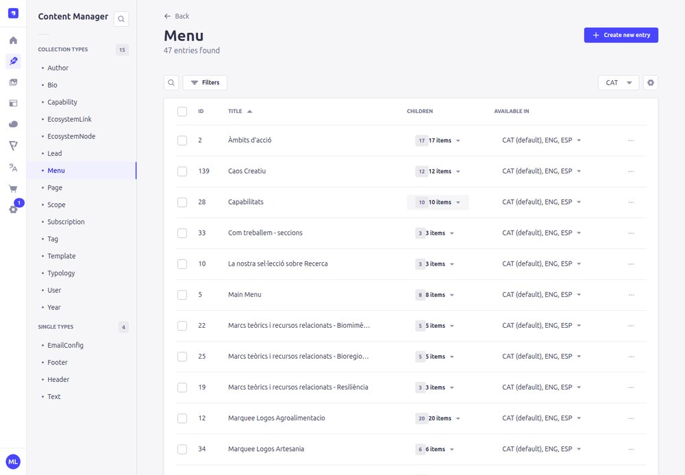

   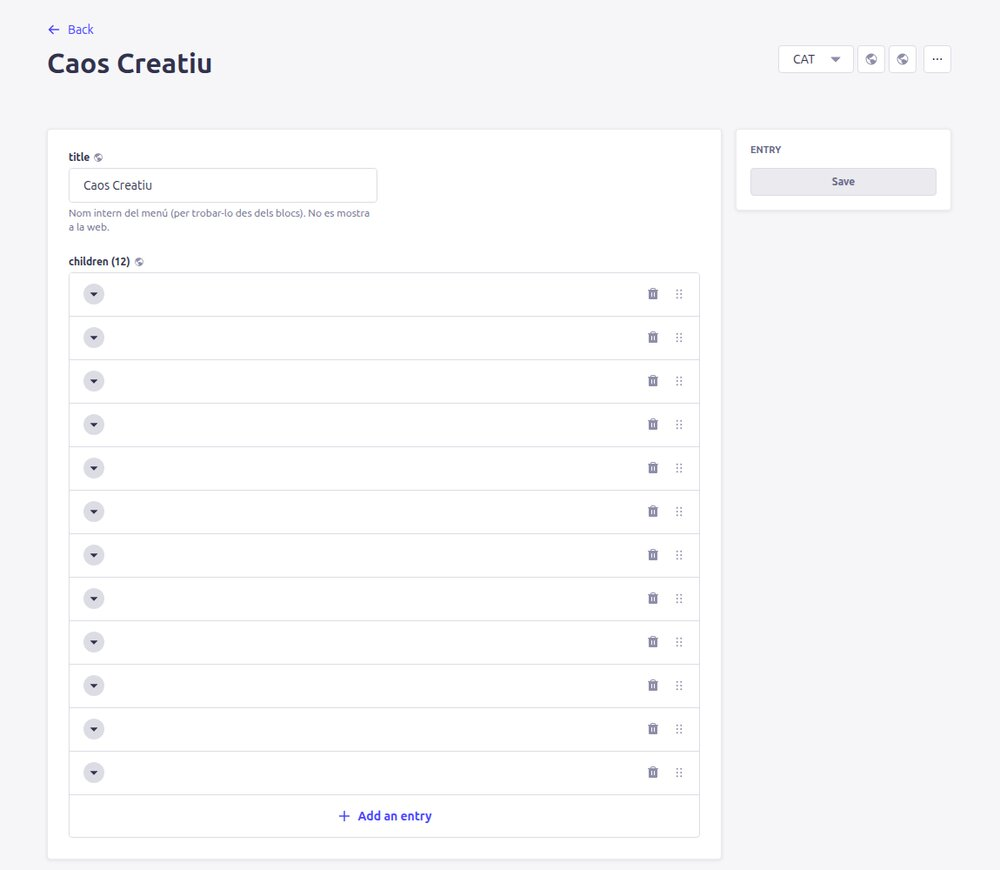

2. Clica **+ Add an entry** (a baix). S'afegeix un element nou al final.
3. Al camp **page**, escriu part del nom de la pàgina i tria-la.

   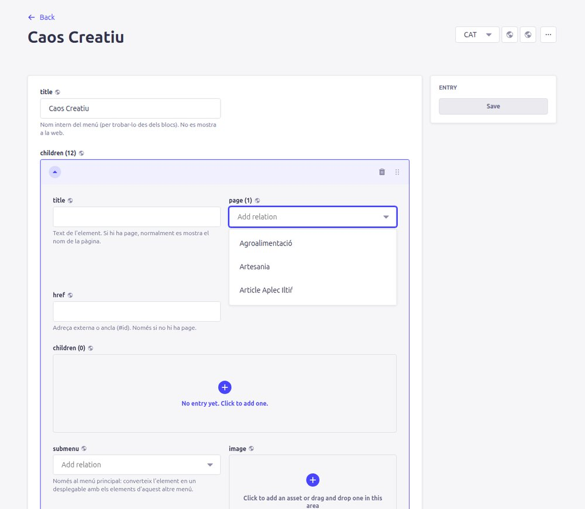

4. *(Recomanat)* Escriu el nom de la pàgina també a **title**. Als sliders no es mostra, però així a la llista de Strapi la fila tindrà nom (si no, totes les files surten en blanc i costa saber quina és quina).
5. Arrossega l'element (icona ⋮⋮) a la posició on el vulguis. **La primera fila és la primera targeta.**
6. **Save**. ⚠️ Els menús no tenen esborrany: en desar, el canvi ja és a la web.
7. Repeteix-ho als idiomes **ESP** i **ENG** del menú, triant la versió traduïda de la pàgina.

### Treure o reordenar

- **Treure**: icona 🗑 de la fila → **Save**. (La pàgina no s'esborra, només deixa de sortir al slider.)
- **Reordenar**: arrossega les files per la icona ⋮⋮ → **Save**.

> Per saber quina pàgina és cada fila en blanc, clica-la per desplegar-la: el camp `page` mostra el nom.
>
> 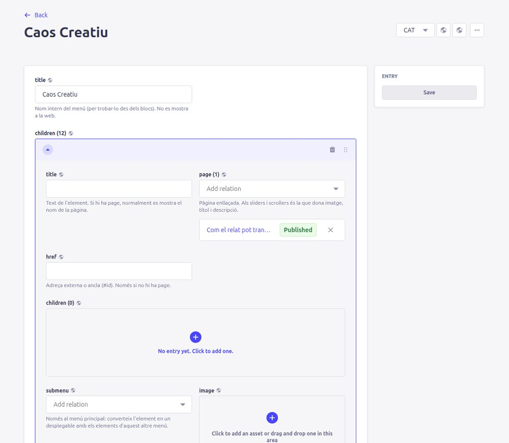

---

## D. Afegir una entrada a un menú

Els menús de navegació també són **Menu**:

| Menú de la web | Menú a editar |
|---|---|
| Menú principal (pantalla completa) | El que indica **Header → mainMenu** (actualment «Main Menu») |
| Enllaços petits al peu del menú principal | **Header → secondaryMenu** («Secondary») |
| Enllaços del peu de pàgina | **Footer → menu** (ara és el mateix «Secondary»: canviar-lo afecta tots dos llocs) |
| Índex «Àmbit d'acció / Serveis / Recursos» de la Home | **Menú Home** |
| Núvol de paraules d'àmbits | **Àmbits d'acció** |
| Cintes de logos de les pàgines d'àmbit | **Marquee Logos ...** |

Veure el formulari del Header

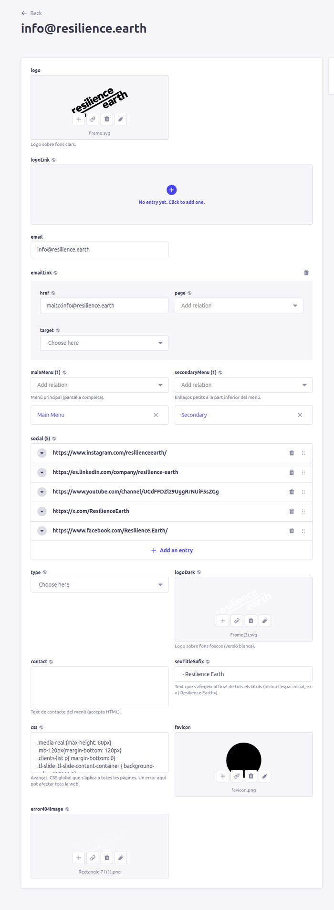

Cada element (*entry*) té:

- **title**: el text de l'enllaç. Al menú principal i al peu, si hi ha una `page`, es mostra el nom de la pàgina i `title` només s'usa si no n'hi ha. Al menú índex de la Home (preset *default*) es mostra **només** `title`.
- **page**: pàgina interna (recomanat: si la pàgina canvia d'adreça, l'enllaç s'actualitza sol).
- **href**: adreça externa (`https://...`) o una àncora dins la mateixa pàgina (`#serveis`). Només si no hi ha `page`.
- **submenu**: només al menú principal: converteix l'element en un desplegable amb els elements d'un altre menú.
- **image**: logo (només a les cintes de logos).

Passos: obre el menú → **+ Add an entry** → omple els camps → arrossega a la posició → **Save** → repeteix a ESP i ENG.

---

## E. Canviar els textos animats de la Home

La capçalera de la Home escriu frases amb animació de màquina d'escriure. **No surten del bloc Hero**, sinó de **Content Manager → Text** → camps `home0` … `home9`:

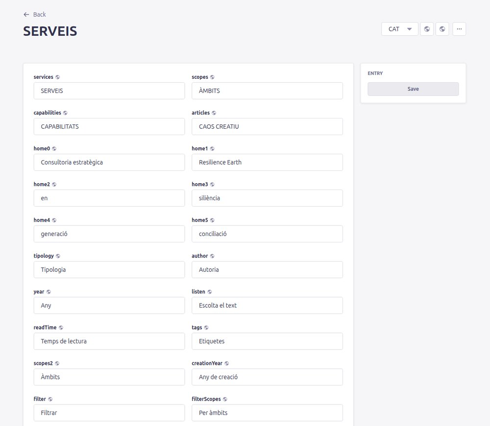

- `home0`: primera línia («Consultoria»).
- `home1`: segona línia, que fa l'efecte de lletres que desapareixen. ⚠️ **No la canviïs** sense parlar amb la persona tècnica: l'efecte està programat per a un text de 16 lletres exactes.
- `home2` … `home9`: frases que es van escrivint i esborrant per ordre. Deixa buides les que no facin falta (l'animació s'atura a la primera buida).

**Save**, i a cada idioma.

---

## F. Mostrar un avís emergent (modal)

El bloc **Modal** mostra una imatge en una finestra emergent en entrar a la pàgina (per exemple, per anunciar un esdeveniment).

1. Obre la pàgina on ha de sortir (p. ex. Home).
2. *Add a component to sections* → **Modal**. Posa'l **al final** (si no, deixa un espai en blanc on és).
3. Omple:
   - `image`: imatge per a ordinador (obligatòria). Opcionalment `imageTablet` i `imageMobile`.
   - `size`: `small` (400 px), `medium` (600 px) o `large` (900 px).
   - `href`: enllaç en clicar la imatge (s'obre en pestanya nova).
   - `displayFrequency`: `once` (un sol cop per persona), `once_per_day` o `every_reload` (sempre).
   - `name`: descripció de la imatge.
4. **Save** + **Publish**.

Per treure'l: esborra el bloc (🗑) → **Save** + **Publish**.

---

## G. Traduir una pàgina

1. Obre la pàgina en català.
2. Canvia l'idioma al desplegable de dalt a la dreta (**ESP** o **ENG**).
3. Si la pàgina encara no existeix en aquest idioma, Strapi obre un formulari buit. Fes servir la icona **«Fill in from another locale»** (globus, a dalt a la dreta) per copiar-hi tot el contingut del català.

   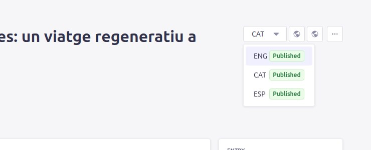

   La segona icona (*Translate from another locale*) fa una **traducció automàtica**. Revisa-la sempre.
4. Tradueix `name`, `slug` (pot ser diferent per idioma, p. ex. `caos-creativo`), metadades i textos.
5. ⚠️ **No tradueixis** els camps tècnics: `cssClass`, `container`, `sectionId`, colors, alçades... Han de quedar exactament igual que en català. (La traducció automàtica de vegades els tradueix, i llavors es perd el disseny: per exemple `orange-titles` → `naranja-títulos` deixa de funcionar.)
6. **Save** + **Publish**.
7. Si cal, afegeix la versió traduïda als menús/sliders d'aquell idioma.

---

## H. Despublicar o esborrar

- **Despublicar** (recomanat): obre la pàgina → **…** al costat de *Publish* → **Unpublish**. Deixa de veure's a la web i a les llistes, però es conserva.
- **Esborrar**: **…** de dalt a la dreta → **Delete entry (CAT)** (només aquest idioma) o **Delete entry (all locales)** (tots).

  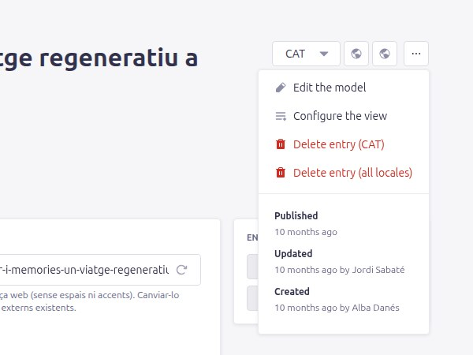

- Abans d'esborrar o despublicar, **treu la pàgina dels menús/sliders** on surti ([recepta C](#c-afegir-treure-o-reordenar-targetes-dun-slider)): si no, quedarà una targeta trencada.

---

## I. Crear una pàgina general nova

Per a una pàgina tipus «Qui som» o «Contacte»:

1. Duplica una pàgina general (`type` = `page`) que s'assembli al disseny que vols.
2. Canvia `name`, `slug`, metadades i blocs.
3. **Save** + **Publish**. L'adreça serà `https://resilience.earth/<slug>`.
4. Afegeix-la al menú que toqui ([recepta D](#d-afegir-una-entrada-a-un-menú)) perquè la gent la pugui trobar.

---

## J. Posar i treure persones de l'equip (Qui som)

Cada persona és una **Bio** (Content Manager → **Bio**): una fitxa amb foto, càrrec, cita i text,
que té pàgina pròpia a `resilience.earth/bio/<slug>`.

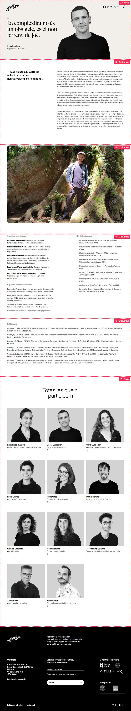

⚠️ **La llista «Totes les que hi participem» és a dos llocs diferents** i s'han d'editar tots dos:

| On es veu | Què s'edita |
|---|---|
| Pàgina [Qui som](https://resilience.earth/qui-som) | Page **qui-som** → bloc **Bios «Totes les que hi participem»** → camp `bios` |
| Al final de **cada fitxa de persona** (`/bio/...`) | Template **bio** → bloc **Bios «Totes les que hi participem»** → camp `bios` |

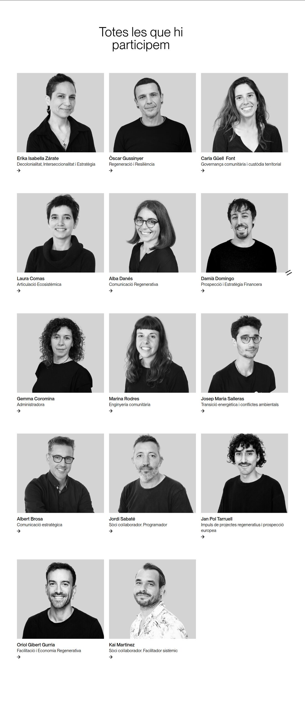

A més, les pàgines d'**àmbit** (Agroalimentació, Cultura...) tenen el seu propi bloc Bios amb les
persones d'aquell àmbit (preset `list`).

### Afegir una persona

1. **Crear la Bio.** Content Manager → **Bio** → idioma **CAT** → duplica una persona existent
   (**…** → *Duplicate*) o *Create new entry*.

   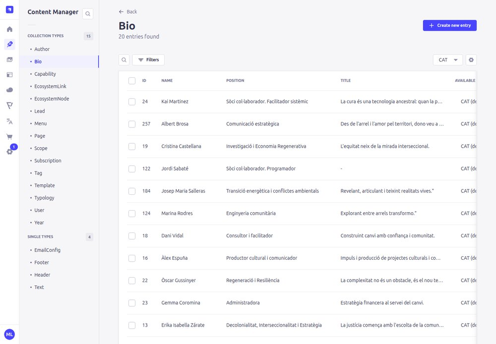

2. Omple els camps:

   | Camp | Què és |
   |---|---|
   | `name` | Nom i cognoms. |
   | `slug` | Adreça de la fitxa (`/bio/<slug>`): clica ⟳. |
   | `position` | Càrrec o rol (surt sota el nom). |
   | `title` | La cita destacada (surt gran, amb cometes). |
   | `excerpt` | Frase destacada de la fitxa. |
   | `mainImage` | **Foto principal** (retrat; surt a les targetes i a la capçalera). |
   | `largeImage` | Foto gran horitzontal dins la fitxa. |
   | `content`, `more1`, `more2`, `more3` | Textos de la fitxa (presentació, trajectòria, publicacions...). |
   | `audio` | Àudio opcional (botó «Escolta»). |
   | `weight` | **Ordre a les llistes**: número més petit = surt abans (sense número = 100). |

   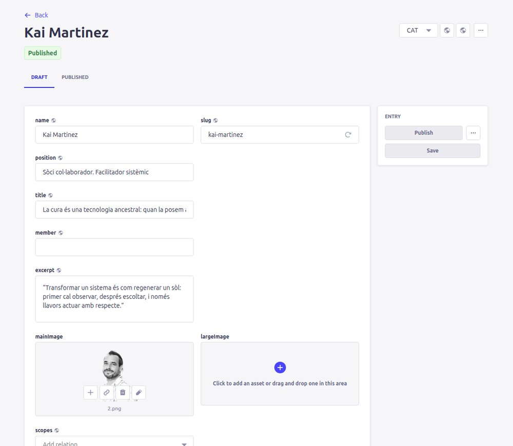

3. **Save** i **Publish**. ⚠️ Una Bio sense publicar **no surt enlloc**.
4. **Afegir-la a «Qui som»:** Content Manager → Page → **Qui som** → baixa fins al bloc
   **Bios - Totes les que hi participem** → al camp **bios**, *Add relation* → escriu el nom i
   tria-la → **Save** + **Publish**.

   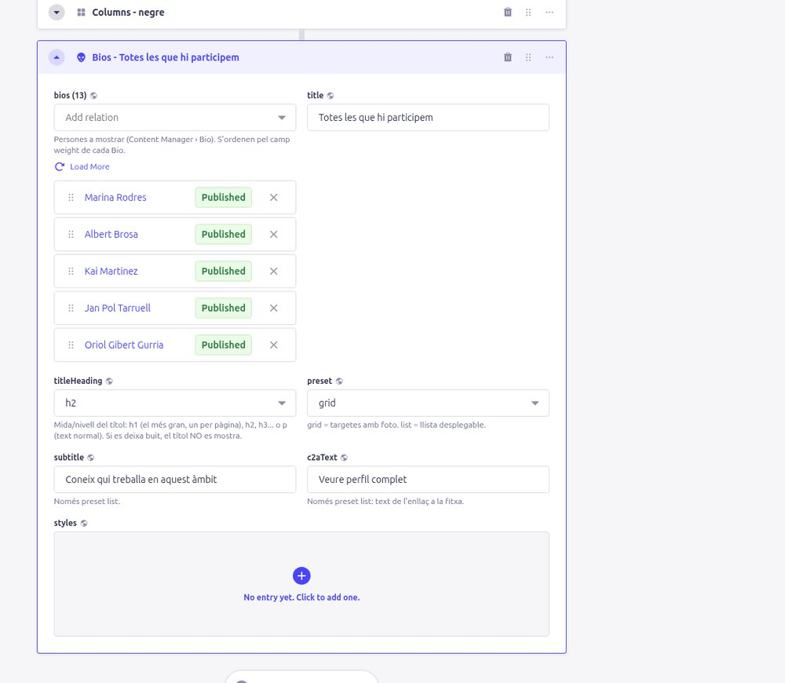

5. **Afegir-la a la plantilla de les fitxes:** Content Manager → **Template** → **bio** → mateix
   bloc → camp **bios** → *Add relation* → **Save** (les plantilles no tenen *Publish*: el canvi és
   immediat).

   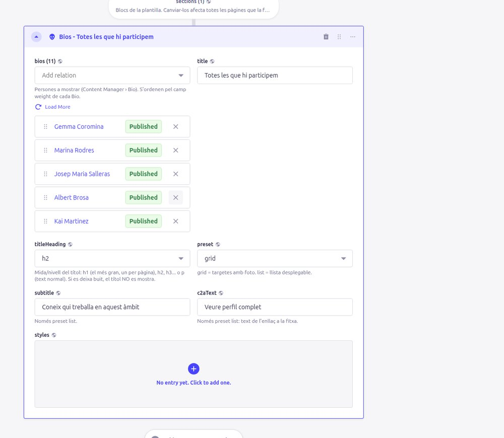

6. Si treballa en algun àmbit, afegeix-la també al bloc Bios de la pàgina d'aquell àmbit.
7. Repeteix-ho als idiomes **ESP** i **ENG**: tradueix la Bio (selector d'idioma de la fitxa) i
   afegeix-la a la pàgina «Quiénes somos» / «Who we are» i a la plantilla `bio` d'aquell idioma.

> L'ordre de les targetes **no** és el de la llista de l'admin: el decideix el camp `weight` de
> cada Bio. La llista de l'admin mostra només unes quantes persones: clica *Load More* per veure-les totes.

### Treure una persona

- **Que no surti a les llistes però mantenir la fitxa:** treu-la (✕) del camp `bios` de *Qui som*,
  de la plantilla `bio` i dels àmbits on surti → **Save** (+ **Publish** a les pàgines).
- **Que no surti enlloc:** obre la Bio → **…** al costat de *Publish* → **Unpublish** (en cada idioma).
  Desapareix de totes les llistes i la seva fitxa deixa d'existir.

## K. Activar Google Analytics (Tag Manager) i el bàner de galetes

Per defecte la web **no fa servir galetes**: no hi ha analítica ni bàner. Els vídeos de YouTube
es carreguen des de `youtube-nocookie.com`, que no posa galetes de seguiment.

Per activar l'analítica:

1. **Header** → camp **gtmId** → escriu el codi que et donin (format `GTM-XXXXXXX`) → **Save**.
   El camp és el mateix per a tots els idiomes.
2. A partir d'aquest moment surt un **bàner de galetes** a la part de baix de la web, amb els
   botons «Rebutjar» i «Acceptar», i al peu de pàgina apareix l'enllaç **«Configuració de
   galetes»** per canviar l'elecció.
3. Tag Manager (i per tant Google Analytics) **només es carrega si el visitant accepta**. Si
   rebutja, la web continua sense galetes. L'elecció es recorda 12 mesos.
4. Textos del bàner (opcionals, per idioma): **cookieText** (accepta HTML; pots escriure
   `{policy}` com a adreça de l'enllaç a la política de privacitat), **cookieAccept**,
   **cookieReject** i **cookieSettings** (l'enllaç del peu). Si els deixes buits, es fan servir
   textos per defecte en català, castellà i anglès.
5. Actualitza la **Política de privacitat** (apartat de galetes) abans d'activar-ho: ha de dir que
   es fa servir Google Analytics, quines galetes posa i quant duren.

Per desactivar-ho, buida el camp **gtmId**.

> Qui configuri el contenidor de Tag Manager: la web ja envia el consentiment (Consent Mode v2)
> amb `analytics_storage` concedit i la publicitat (`ad_storage`, `ad_user_data`,
> `ad_personalization`) denegada. La web és una SPA: la pàgina vista de GA4 s'ha de comptar
> també en els canvis d'URL (mesura millorada de GA4 o un activador *History Change*).

[← Strapi bàsic](02-strapi-basic.md) · [Següent: Blocs →](04-blocs.md)
