# 4. Els blocs, un per un

[← Índex](README.md)

Tots els blocs tenen un apartat **styles** (colors, fons, espais, amplada, classes CSS) que s'explica a [Estils i maquetació](05-estils.md). Aquí expliquem què fa cada bloc i els seus camps propis.

Molts blocs tenen el parell **title + titleHeading**. `titleHeading` és la mida del títol: `h1` (el més gran; només un per pàgina), `h2`, `h3`, `h4`, `h5` o `p` (text normal). ⚠️ **Si `titleHeading` és buit, el títol no es mostra.** Els títols accepten ` ` per partir la línia.

El camp **alias** que tenen alguns blocs és només un nom intern per reconèixer el bloc a la llista de Strapi (surt al costat del tipus: «Columns - images»). No es veu a la web.

| Bloc | Ús | Freqüència |
|---|---|---|
| [Hero](#hero) | Capçalera | ★★★ |
| [Columns](#columns) | Text, imatges, botons | ★★★ |
| [Slider](#slider) | Carrusel de targetes | ★★★ |
| [Masonry](#masonry) | Mosaic d'articles | ★★ |
| [Blog](#blog) | Llista de recursos | ★★ |
| [Menu](#menu) | Enllaços, núvol, cinta de logos, anterior/següent | ★★ |
| [Template](#template) | Inserir una plantilla | ★★ |
| [Video](#video) | Vídeo de YouTube/Vimeo amb portada | ★★ |
| [Blurbs](#blurbs) | Xifres o icones en fila | ★ |
| [Bios](#bios) | Equip | ★ |
| [Capabilities](#capabilities) | Llista desplegable de capabilitats | ★ |
| [Tabs](#tabs) | Pestanyes | ★ |
| [Timeline](#timeline) | Línia de temps | ★ |
| [LeadForm](#leadform) | Formulari de contacte | ★ |
| [Modal](#modal) | Finestra emergent | ★ |
| [Scroller](#scroller) | Targetes que es desplacen en horitzontal | (no s'usa) |
| [Ecosystem](#ecosystem) | Gràfic de xarxa | (no s'usa) |

---

## Hero

La capçalera gran de la pàgina.

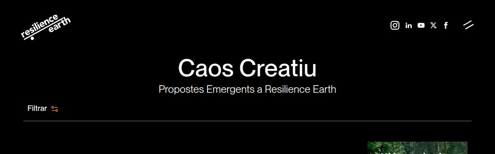

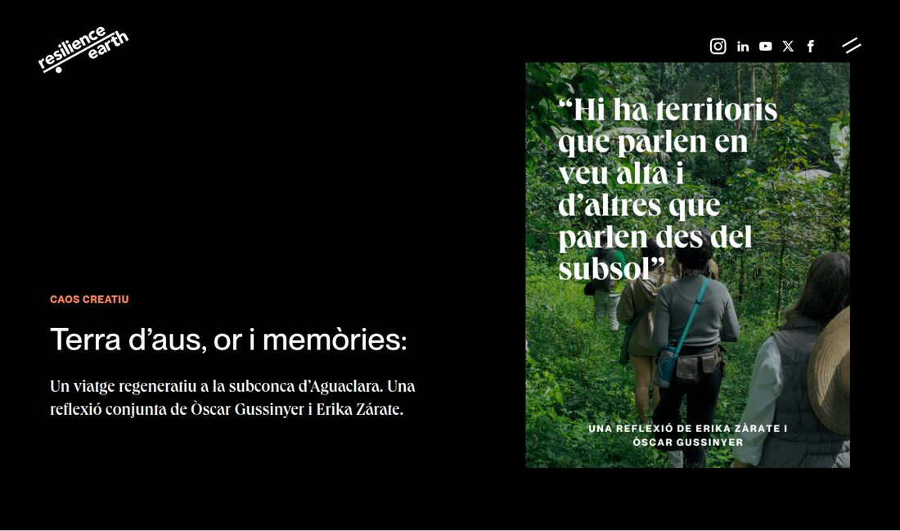

| Camp | Què fa |
|---|---|
| `title` | Títol gran. |
| `titleHeading` | Mida del títol. Normalment `h1`. |
| `text` | Subtítol. Només admet paràgrafs, títols i negreta (no llistes ni enllaços). |
| `align` | `bottom-left`: text a baix a l'esquerra. `centered`: centrat. (`post` no té efecte.) |
| `styles → height` | Alçada: `450px`, `85vh` (85% de la pantalla)... |
| `styles → backgroundColor` / `backgroundImage` / `backgroundVideo` | Fons. Als **articles**, `backgroundImage` no es posa de fons sinó com a imatge a la dreta. |
| `styles → textColor` | `light` si el fons és fosc. |

Particularitats:
- A la **Home**, el títol i el text del Hero no s'usen: l'animació surt de **Text → home0…home9** ([recepta E](03-receptes.md#e-canviar-els-textos-animats-de-la-home)).
- Als articles, recursos, serveis i capabilitats, sobre el títol surt una etiqueta petita automàtica («Caos Creatiu», «Eines disruptives»...).

---

## Columns

El bloc més versàtil: una fila amb una o més **columnes**. Cada columna pot tenir títol, text, una imatge/vídeo/àudio i un botó.

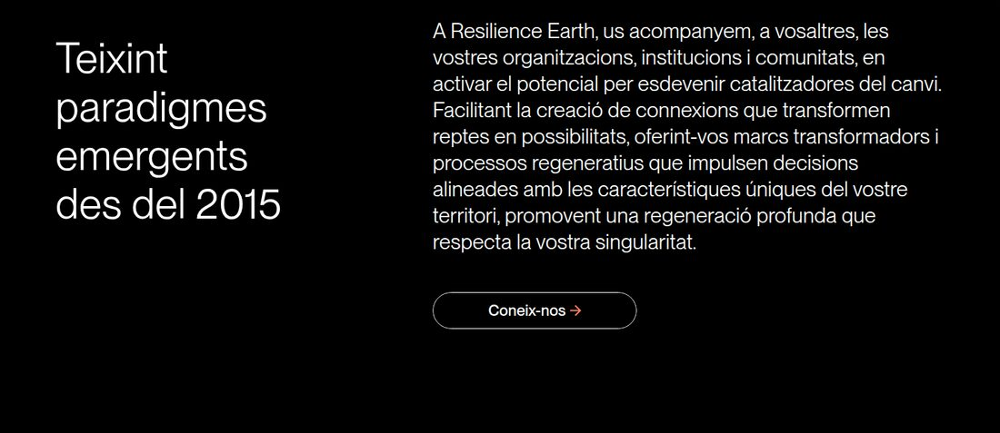

*Aquest bloc té 3 columnes: «Teixint paradigmes...» (4/12), una columna buida d'espai (1/12) i el text amb el botó (7/12).*

Camps del bloc:

| Camp | Què fa |
|---|---|
| `columns` | Llista de columnes, d'esquerra a dreta. **+ Add an entry** per afegir-ne. |
| `styles` | Estils del bloc sencer (fons, espais, amplada del contenidor...). |
| `alias` | Nom intern. |

Camps de **cada columna**:

| Camp | Què fa |
|---|---|
| `title` + `titleHeading` | Títol de la columna. |
| `text` | Text amb format (títols, negreta, cursiva, llistes, enllaços). |
| `media` | Imatge, vídeo (amb controls) o àudio, sota el text. |
| `c2a` | Un botó: `text`, `page` (pàgina interna) o `href` (adreça), `target` i `cssClass` (aspecte). Vegeu [Botons](05-estils.md#7-botons). |
| `styles → cssClass` | **L'amplada de la columna** (graella de 12) i altres classes. Vegeu [Graella](05-estils.md#1-la-graella-de-12-columnes). |
| `styles → backgroundImage` | Imatge de fons de la columna. |
| `styles → padding` / `margin` | Espai al voltant de cada paràgraf de text i del botó. |
| `verticalScroller` | Avançat: mosaic animat d'imatges (Home). |
| `alias` | Nom intern. |

A la columna, la resta de camps de `styles` (color, contenidor...) **no tenen efecte**: es posen al bloc.

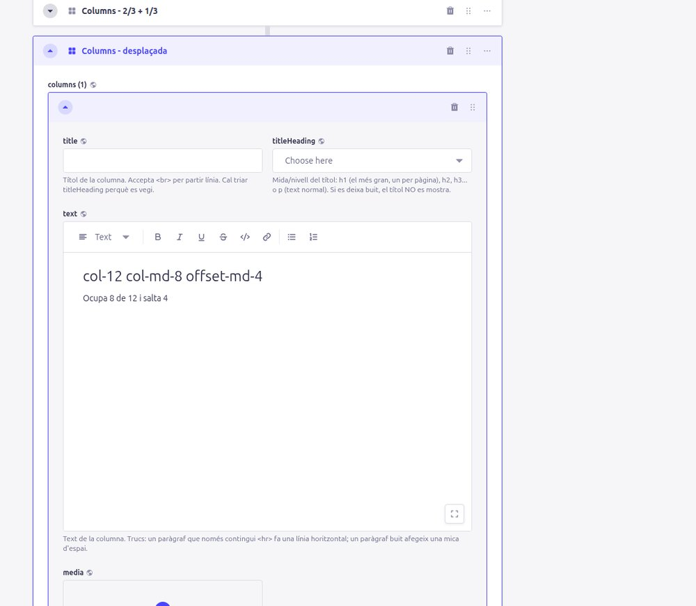

Classes especials per a Columns: `fixed-when-scroll` (la columna es queda fixa mentre fas scroll, a ordinador), `columns-with-text-slider` (textos que es van alternant). Vegeu [Classes CSS](05-estils.md#6-classes-css).

---

## Slider

Carrusel de targetes. **Les targetes surten d'un Menu** ([recepta C](03-receptes.md#c-afegir-treure-o-reordenar-targetes-dun-slider)): cada element del menú és una pàgina, i la targeta mostra la seva imatge de compartir, nom, descripció curta i tipologia.

**Preset `three`** amb la classe `slider-three-black`: 3 targetes fosques que roten.

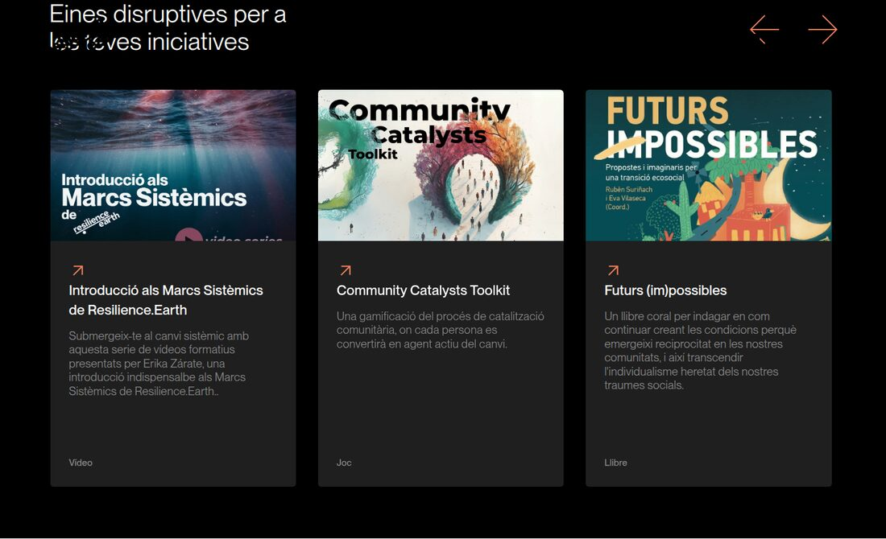

**Preset `three`** amb les classes `slider-three-black slider-three-black-kaos orange-titles`: versió Caos Creatiu, imatges altes.

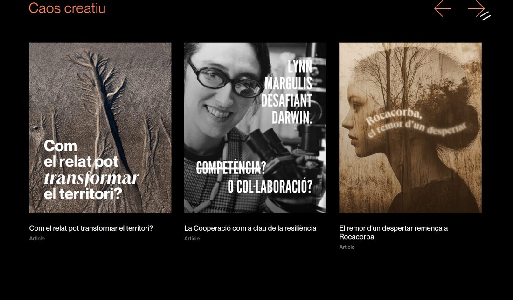

**Preset `services`**: targetes amb una barra de color, es mouen amb les fletxes (sense moviment automàtic).

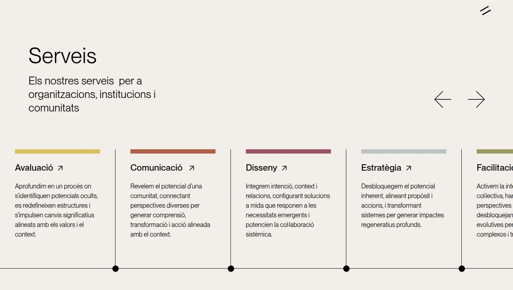

| Camp | Què fa |
|---|---|
| `menu` | El menú d'on surten les targetes. |
| `preset` | `three` (3 targetes), `services` (targetes de colors), `one` (una diapositiva gran amb imatge i text). `three-black` no es recomana (l'aspecte fosc es fa amb la classe). |
| `subTitle` | Amb `three`: és el **títol visible** a dalt a l'esquerra. Amb `one`: text petit sobre el títol. Amb `services`: text sota el títol. |
| `title` | Només es veu amb `one` i `services`. |
| `intervalMilliseconds` | Temps entre canvis (8000 = 8 s). No s'aplica a `services`. |
| `goToText`, `c2a` | Només amb `one`: text de l'enllaç de cada diapositiva i botó final. |
| `styles → cssClass` | `slider-three-black` (fosc), `slider-three-black-kaos` (variant Caos), `orange-titles` (títol taronja). |

---

## Masonry

El mosaic d'imatges de **Caos Creatiu** (i de la Home). Mostra **automàticament tots els articles publicats**, del més recent al més antic (`sortDate`). Només es veu la `shareImage` de cada article.

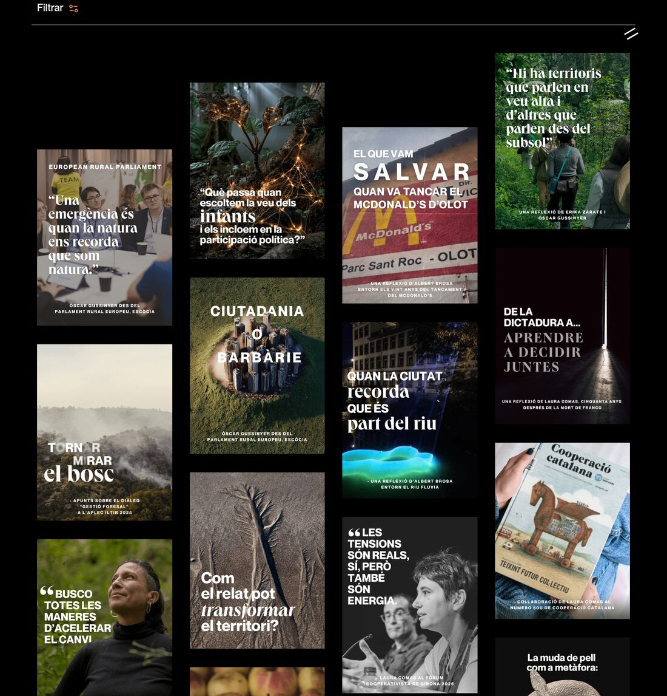

| Camp | Què fa |
|---|---|
| `title`, `subtitle` | Títol i text petit a sobre. |
| `filter` | `TRUE`: mostra el botó «Filtrar» (per àmbit, tipologia i any) i el botó «Carregar més». **Deixa'l a TRUE**: si és FALSE només surten els primers articles i no se'n poden veure més. |
| `pageSize` | Quants articles es carreguen cada vegada (per defecte 16). |
| `noResultsImage` | Imatge quan un filtre no dona resultats. |
| `pages` | **Sense efecte** (la llista és automàtica). |

---

## Blog

La llista de **Eines disruptives**.

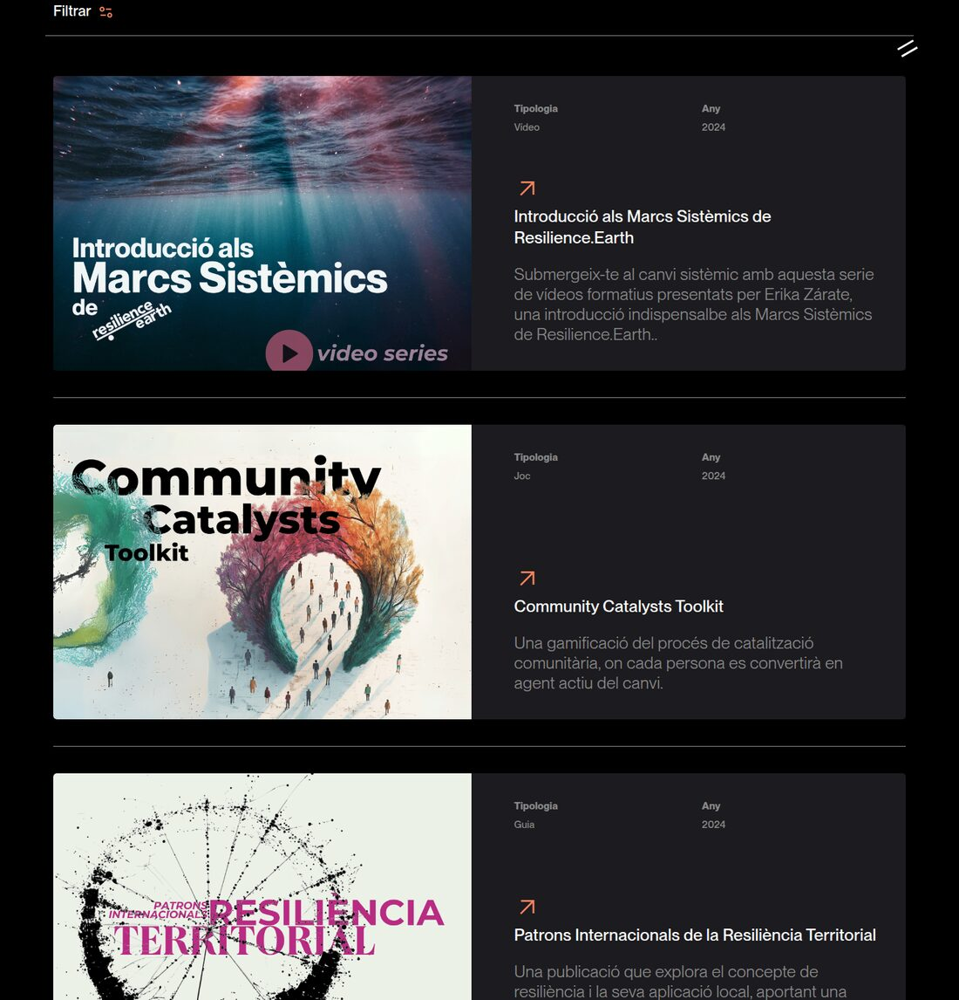

Té dos modes segons el camp `filter`:
- **`filter` = TRUE** (el que s'usa): llista **automàtica de tots els recursos publicats** (`type` = `resource`), amb filtres i «Carregar més». Ordenats per **última modificació**.
- **`filter` = FALSE**: llista **manual** del camp `blogPage`. Cada element té `page` i `width` (`onethird` = 1/3, `twothirds` = 2/3, `threethirds` = fila sencera).

Classe `blog-black` a `cssClass`: targetes fosques.

---

## Menu

Mostra els elements d'un **Menu** de quatre maneres (`preset`):

**`default`**: enllaços amb fletxa avall, pensats com a índex de la pàgina (amb `href` = `#identificador` d'un bloc; vegeu `sectionId` a [Estils](05-estils.md#5-colors-i-fons)). Mostra el `title` de cada element.

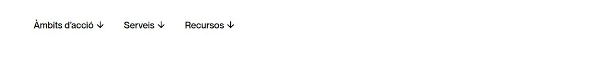

**`tags-cloud`**: paraules grans separades per «/». En passar el ratolí surt la imatge de compartir de la pàgina. (Amagat a mòbil.)

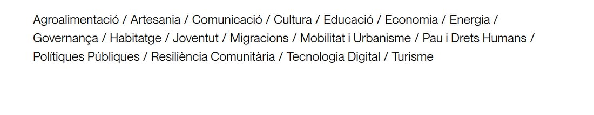

**`marquee`**: cinta que es desplaça sola. Si els elements tenen `image`, mostra logos (enllaçats a `href`); si no, text.

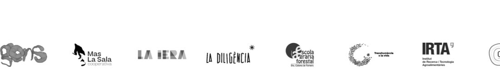

**`navigation-arrows`**: enllaços «← anterior» i «següent →» segons la posició de la pàgina actual dins del menú (s'usa a les capabilitats).

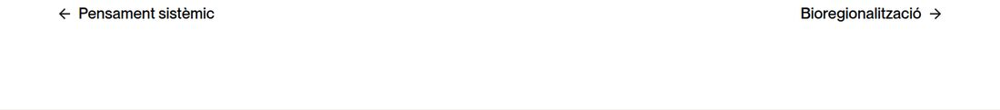

`title-sections` no mostra res.

---

## Template

Insereix en aquesta posició tots els blocs d'una **plantilla** (Content Manager → Template). Serveix per a blocs que es repeteixen a moltes pàgines: si canvies la plantilla, canvia a totes. Vegeu [Plantilles](06-plantilles.md).

| Camp | Què fa |
|---|---|
| `template` | La plantilla a inserir. |

---

## Video

Imatge de portada amb un botó ▶. En clicar-lo, es reprodueix el vídeo a la mateixa pàgina.

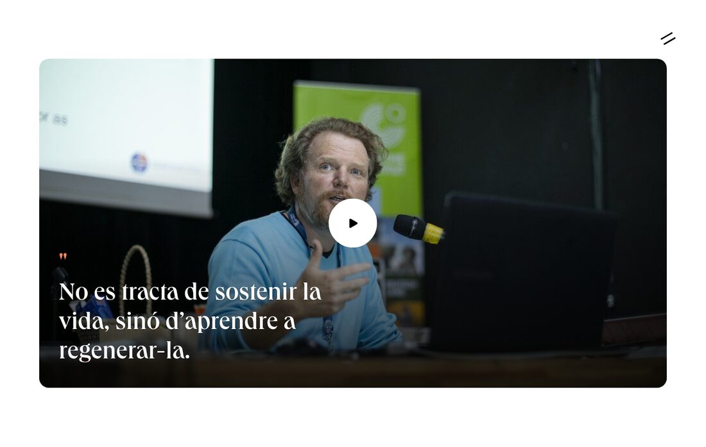

| Camp | Què fa |
|---|---|
| `image` | Portada (imprescindible). |
| `title` | Frase sobre la portada (lletra serif, amb cometes taronja). |
| `url` | Enllaç de YouTube (`https://www.youtube.com/watch?v=...` o `https://youtu.be/...`) o enllaç d'inserció de Vimeo (`https://player.vimeo.com/video/...`). |
| `embed` | Sense efecte. |

Per a un vídeo **pujat a Strapi** (mp4), fes servir el camp `media` d'una columna.

---

## Blurbs

Una fila d'elements iguals: imatge, títol i text (p. ex. les xifres de la Home).

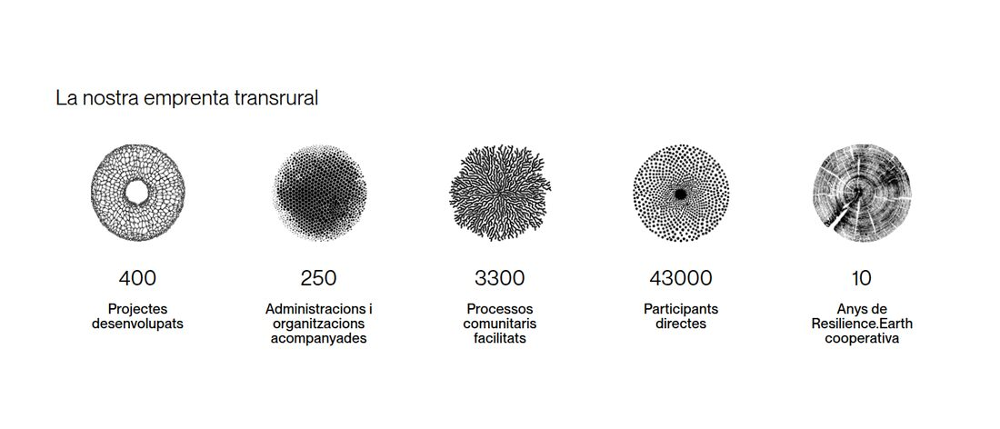

Cada element (`blurbs`) té `image` (142 px d'alt), `title` + `titleHeading` i `text` (text pla, sense negretes ni enllaços). Els camps `imagePosition`, `imageWidth`, `cssClass`, `svg` i `effect` no tenen efecte.

---

## Bios

Fitxes de persones de l'equip (Content Manager → **Bio**).

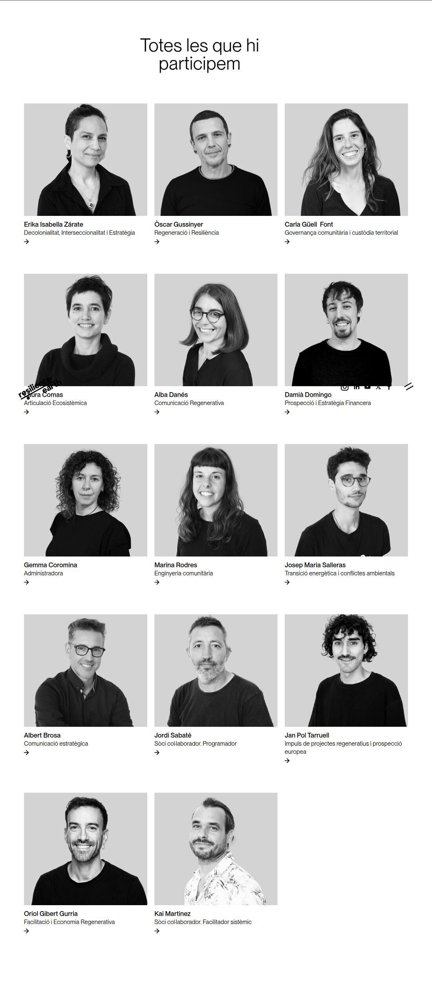

| Camp | Què fa |
|---|---|
| `bios` | Les persones a mostrar. L'ordre el decideix el camp `weight` de cada Bio (número més petit = abans). |
| `title` + `titleHeading` | Títol. |
| `preset` | `grid` (targetes amb foto) o `list` (llista desplegable; mostra també `subtitle` i l'enllaç `c2aText`). |

Cada Bio té pàgina pròpia (`/bio/slug`) generada a partir dels seus camps: `name`, `position`, `title` (la cita), `mainImage`, `largeImage`, `excerpt`, `content`, `more1`, `more2`, `more3`, `audio`.

---

## Capabilities

Llista desplegable de capabilitats (pàgina «Com treballem»).

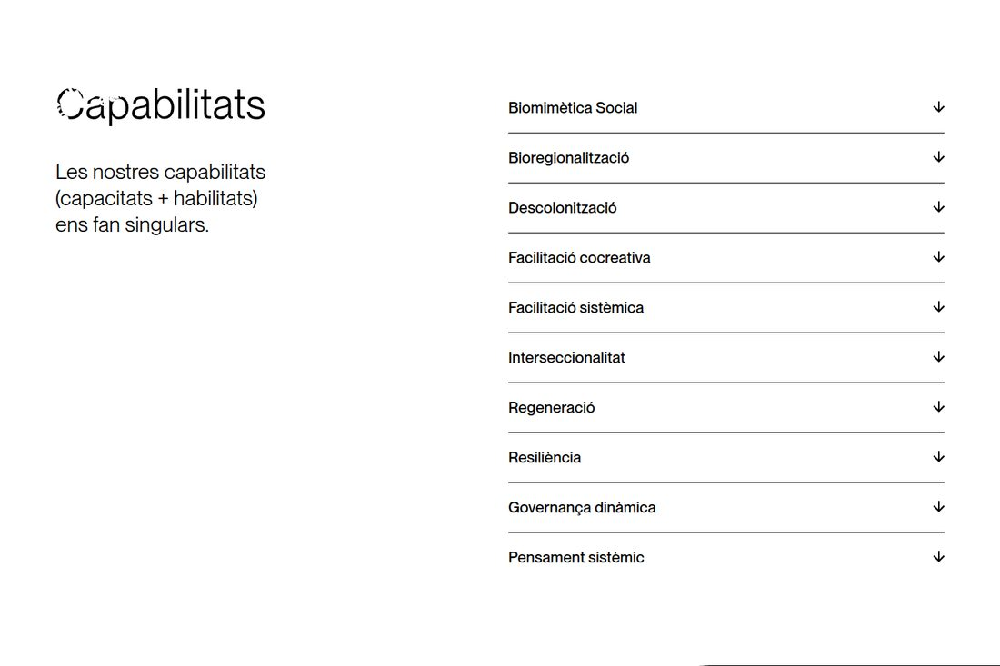

`title`, `subtitle`, `description` (a l'esquerra) i `capabilities` (les capabilitats, de Content Manager → **Capability**: `name`, `description`, `audio` i `page`). `c2aText` és el text de l'enllaç a la pàgina de cada capabilitat (si és buit, l'enllaç no es veu).

---

## Tabs

Pestanyes: a l'esquerra els títols, a la dreta el contingut de la pestanya activa (canvia en passar el ratolí o clicar).

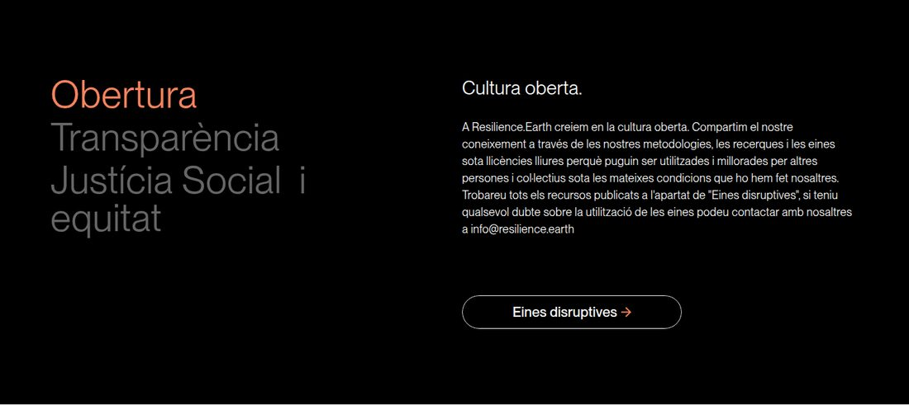

Cada pestanya és com una columna (`title`, `text`, `media`, `c2a`). Fes servir **`titleHeading` = `h2`** perquè el títol surti a la llista de l'esquerra amb l'estil correcte.

---

## Timeline

Línia de temps interactiva de [TimelineJS](https://timeline.knightlab.com/) (s'usa a les pàgines d'àmbit).

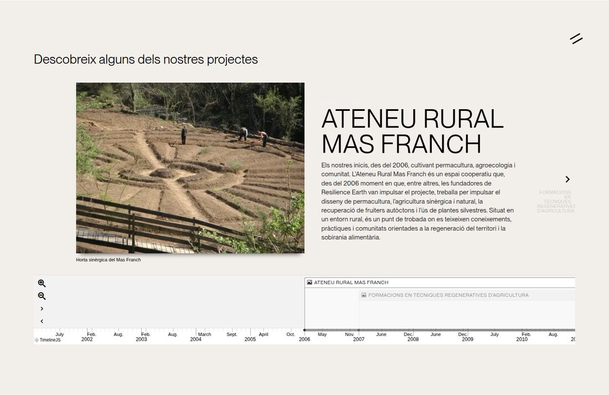

`url`: adreça de la línia de temps (es fa amb un full de càlcul de Google publicat, seguint les instruccions de TimelineJS). El títol surt de **Text → timelineTitle**.

---

## LeadForm

Formulari de contacte (pàgina Contacte).

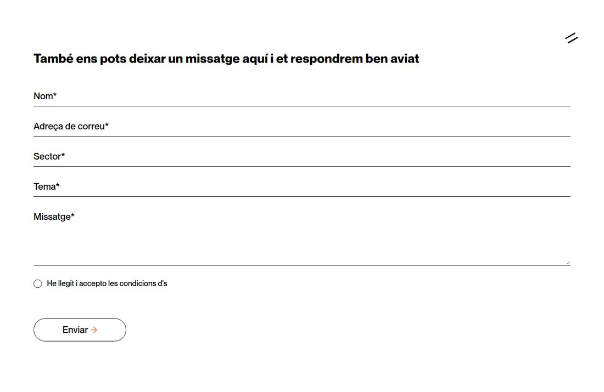

`name`: títol sobre el formulari. Els textos dels camps i missatges surten de **Content Manager → Text** (`name`, `email`, `sector`, `subject`, `message`, `acceptTerms`, `sendMessage`, `thankYou`...). Els missatges rebuts es guarden a **Lead** i s'envien per correu segons **EmailConfig** (`leadEmail1To` = a qui s'envia).

---

## Modal

Finestra emergent amb una imatge. Vegeu [recepta F](03-receptes.md#f-mostrar-un-avís-emergent-modal).

---

## Scroller

Targetes que es desplacen en horitzontal mentre fas scroll vertical. Les targetes surten d'un menú (`preset` `pages`: imatge de compartir + nom de la pàgina; `images`: només la `image` de cada element). Actualment no s'usa a cap pàgina.

## Ecosystem

Gràfic de nodes i enllaços (dades a EcosystemNode i EcosystemLink). Actualment no s'usa.

[← Receptes](03-receptes.md) · [Següent: Estils →](05-estils.md)
