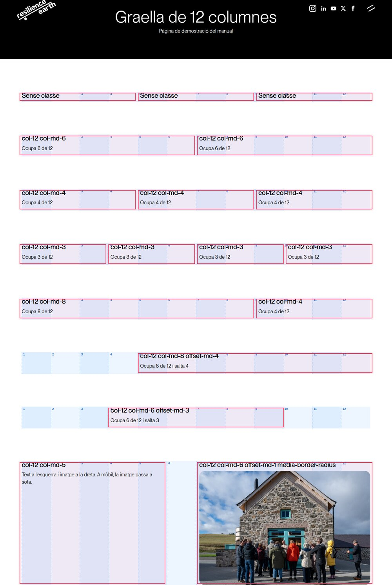
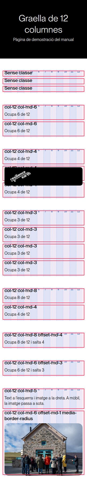
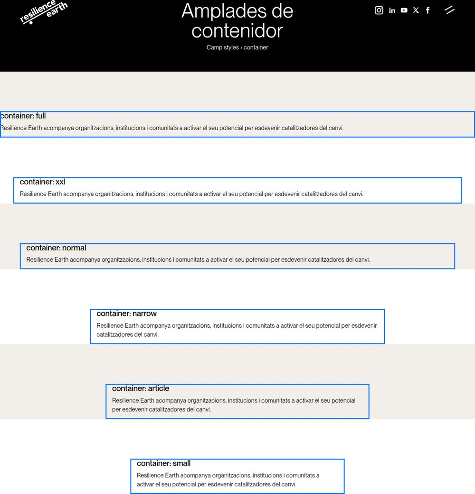
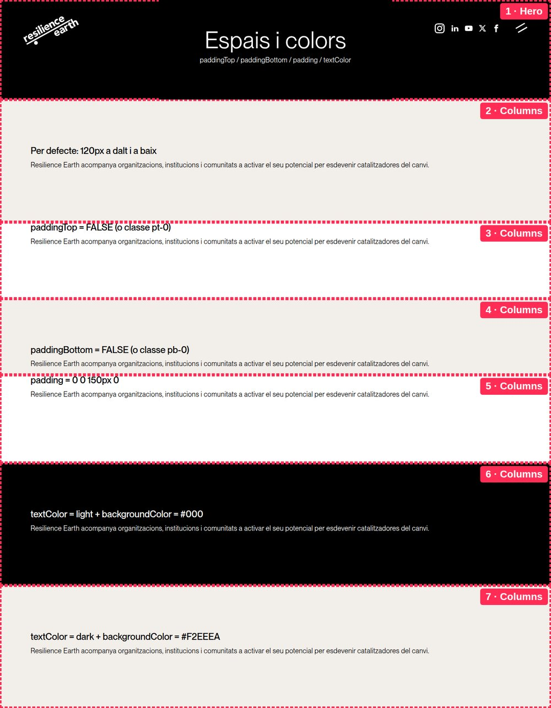
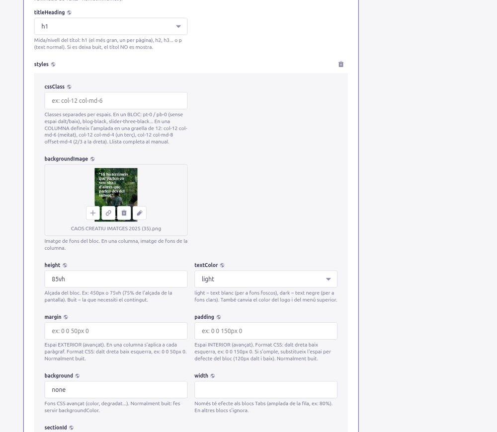
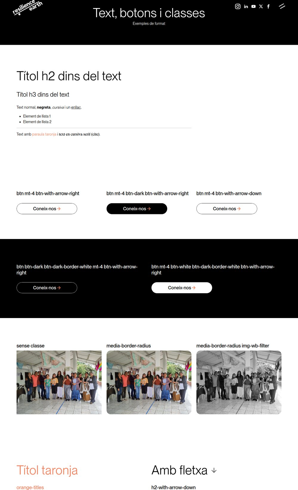

# 5. Estils i maquetació

[← Índex](README.md)

Cada bloc té un apartat **styles** i, dins dels blocs *Columns* i *Tabs*, cada columna també en té un. Aquí s'explica cada camp amb exemples visuals.

> **Consell d'or:** no inventis estils. Busca a la web una part que s'assembli al que vols, obre aquella pàgina a Strapi i **copia els valors** de `styles` (o duplica la pàgina). Així tot queda coherent amb el disseny.

Índex del capítol:
1. [La graella de 12 columnes](#1-la-graella-de-12-columnes)
2. [Amplada del contingut (container)](#2-amplada-del-contingut-container)
3. [Espais: padding i margin](#3-espais-padding-i-margin)
4. [Alçada (height)](#4-alçada-height)
5. [Colors i fons](#5-colors-i-fons)
6. [Classes CSS](#6-classes-css)
7. [Botons](#7-botons)
8. [Trucs dins del text](#8-trucs-dins-del-text)

---

## 1. La graella de 12 columnes

Imagina que l'amplada de la pàgina està dividida en **12 franges iguals**. Cada columna d'un bloc *Columns* diu **quantes franges ocupa**. Això es fa escrivint unes **classes** al camp `cssClass` de l'apartat `styles` **de la columna**.



*En blau, les 12 franges. En vermell, cada columna amb la classe que té escrita.*

### Les classes de la graella

| Escriu a `cssClass` | Resultat a l'ordinador |
|---|---|
| *(res)* | Totes les columnes del bloc es reparteixen l'espai a parts iguals. |
| `col-12 col-md-6` | Meitat de l'amplada (6 de 12). |
| `col-12 col-md-4` | Un terç (4 de 12). |
| `col-12 col-md-3` | Un quart (3 de 12). |
| `col-12 col-md-8` | Dos terços (8 de 12). |
| `col-12 col-md-5`, `col-md-7`... | 5 de 12, 7 de 12... (qualsevol número de l'1 al 12). |
| `col-12 col-md-8 offset-md-4` | Ocupa 8 i **deixa 4 franges buides a l'esquerra** (text a la dreta). |
| `col-12 col-md-6 offset-md-3` | Ocupa 6 i salta 3: **centrada**. |
| `col-12 col-md-6 offset-md-1` | Ocupa 6 i deixa 1 franja d'espai a l'esquerra (separació entre columnes). |

Com es llegeix:
- **`col-12`** = «a **mòbil**, ocupa les 12 franges» (tota l'amplada). Posa-ho sempre: així a mòbil les columnes queden una sota l'altra.
- **`col-md-6`** = «a partir de **tauleta/ordinador** (`md`), ocupa 6 franges».
- **`offset-md-4`** = «a partir de tauleta/ordinador, **salta** 4 franges abans de començar».
- També existeix `col-lg-...` i `offset-lg-...` (`lg` = només a pantalles grans, a partir de 992 px). Ex: `col-12 col-lg-4`.

**Regla:** dins d'un mateix bloc, els números (columnes + salts) haurien de **sumar 12 o menys**. Si sumen més de 12, l'última columna baixa a una línia nova.

| Exemple | Suma |
|---|---|
| `col-md-6` + `col-md-6` | 6 + 6 = 12 ✅ |
| `col-md-4` + `col-md-4` + `col-md-4` | 12 ✅ |
| `col-md-5` + `col-md-6 offset-md-1` | 5 + 1 + 6 = 12 ✅ |
| `col-md-8` + `col-md-6` | 14 ❌ (la segona baixa a sota) |

### Què passa a mòbil

A mòbil, amb `col-12`, cada columna ocupa tota l'amplada i es posen **una sota l'altra**, en el mateix ordre que a Strapi:



### Columnes buides com a separador

Una columna sense contingut amb `col-12 col-lg-1` fa d'espai entre dues columnes (la Home ho fa servir). És equivalent a fer servir `offset`.

### Altres classes que es poden afegir a una columna

Al mateix camp `cssClass` de la columna, separades per espais, pots afegir: `media-border-radius` (imatge amb cantonades rodones), `pt-5` (espai a dalt), `pb-5`, `mb-5` (espai a baix)... Vegeu [Classes CSS](#6-classes-css).

Exemple real (Home): `pt-4 ms-auto col-12 col-lg-7`.

---

## 2. Amplada del contingut (container)

El camp `container` (a `styles` **del bloc**) decideix fins on arriba el contingut a pantalles grans. El fons del bloc sempre ocupa tota l'amplada; el que canvia és el contingut.



| `container` | Amplada màxima | Ús típic |
|---|---|---|
| `full` | Tota la pantalla, sense marges | Imatges de banda a banda |
| `xxl` | Tota la pantalla menys 40 px per banda | Imatges grans de recursos, sliders |
| *(buit)* o `normal` | ~1300 px (estàndard) | La majoria de blocs |
| `narrow` | ~900 px | Blocs de text centrats |
| `article` | 800 px | Text dels articles (lectura còmoda) |
| `small` | ~650 px | Capçaleres petites, textos curts |

Dins d'aquest contenidor s'aplica la graella de 12 columnes.

---

## 3. Espais: padding i margin



### Què és el padding i el margin

```
          ┌──────────────── margin (espai FORA del bloc) ────────────────┐
          │  ┌────────────── vora del bloc (fons de color) ────────────┐  │
          │  │            padding (espai DINS del bloc)                 │  │
          │  │        ┌──────────────────────────────┐                  │  │
          │  │        │          CONTINGUT           │                  │  │
          │  │        └──────────────────────────────┘                  │  │
          │  └──────────────────────────────────────────────────────────┘  │
          └────────────────────────────────────────────────────────────────┘
```

- **padding** = espai **interior**: entre la vora del bloc i el contingut. El color de fons hi arriba.
- **margin** = espai **exterior**: separa el bloc dels altres. El color de fons **no** hi arriba.

### L'espai per defecte

Cada bloc té per defecte **120 px de padding a dalt i a baix** (50 px a mòbil). Els Hero no en tenen.

### Treure l'espai de dalt o de baix (el més habitual)

Per enganxar dos blocs (per exemple, un títol amb el bloc de sota), treu l'espai:

| Vull | Opció A (camps) | Opció B (classe a `cssClass` del bloc) |
|---|---|---|
| Sense espai a dalt | `paddingTop` = **FALSE** | `pt-0` |
| Sense espai a baix | `paddingBottom` = **FALSE** | `pb-0` |
| Sense espai ni a dalt ni a baix | els dos a FALSE | `py-0` |

### Espais intermedis amb classes

En lloc de 0 o 120 px, pots posar un espai intermedi amb classes de la mena `pt-N` / `pb-N` / `py-N` (dalt / baix / tots dos), on N va de 0 a 5:

| Classe | Espai |
|---|---|
| `pt-0` | 0 |
| `pt-1` | 4 px |
| `pt-2` | 8 px |
| `pt-3` | 16 px |
| `pt-4` | 24 px |
| `pt-5` | 48 px |
| `pt-80px` | 80 px (classe pròpia de la web) |

Funcionen tant al bloc (substitueixen els 120 px per defecte d'aquell costat) com a la columna (afegeixen espai dins la columna).

El mateix existeix per al **margin**: `mt-N` (dalt), `mb-N` (baix), `my-N`. I amb valors propis: `mb-120px` (120 px a baix), `mt-150-n` (puja el bloc 150 px **per sobre** de l'anterior, s'usa sota els Hero de Caos Creatiu i Eines).

### El camp padding / margin (avançat)

Si cal un valor exacte, escriu-lo al camp `padding` (o `margin`) en format CSS: **dalt dreta baix esquerra**, en px:

| Escric | Significa |
|---|---|
| `0` | Cap espai. |
| `0 0 150px 0` | 150 px només a baix. |
| `50px 0 0 0` | 50 px només a dalt. |
| `0 50px 0 0` | 50 px només a la dreta. |

⚠️ Si omples `padding` al bloc, **substitueix** els 120 px per defecte (el que no escriguis queda a 0). En una **columna**, `padding` i `margin` s'apliquen a **cada paràgraf** del text, no a la columna sencera.

---

A Strapi, tots aquests camps estan a l'apartat `styles` del bloc:



## 4. Alçada (height)

`height` (normalment als Hero): `450px` (fixa), o `75vh` = 75% de l'alçada de la pantalla (s'adapta a cada pantalla). Buit = l'alçada que necessiti el contingut.

---

## 5. Colors i fons

| Camp | Què fa |
|---|---|
| `backgroundColor` | Color de fons en hexadecimal. Colors de la web: `#000` (negre), `#F2EEEA` (crema), `#FFFFFF` (blanc). Àmbits: `#D9C05D`, `#B06047`, `#9A5567`, `#BBC4C3`, `#999B65`, `#6E5655`, `#B2896E`. |
| `textColor` | `light` = text blanc (per a fons foscos); `dark` = text negre. **També canvia el logo i el menú superior** quan aquest bloc passa per sota: amb un fons fosc posa sempre `light`. |
| `backgroundImage` | Imatge de fons. Per omplir tot el bloc afegeix les classes `bg-cover bg-no-repeat`. |
| `backgroundImage2` | Segona imatge, a la dreta (meitat d'amplada). |
| `backgroundVideo` / `backgroundVideoMobile` | Vídeo de fons (mp4, sense so, en bucle); el de mòbil s'usa a pantalles ≤ 1024 px. |
| `background` | Valor CSS avançat; normalment buit. |
| `sectionId` | Nom per enllaçar directament al bloc: si poses `serveis`, l'enllaç `https://resilience.earth/#serveis` porta a aquest bloc. Sense espais ni accents. |
| `width` | Només funciona als blocs Tabs. |

---

## 6. Classes CSS

Les classes són paraules clau que s'escriuen a `cssClass`, **separades per espais**, i que canvien l'aspecte. Només funcionen les que existeixen: una paraula inventada o mal escrita simplement no fa res (per exemple, una classe que comença per `z` com `zbtn-dark` és una classe «desactivada» a propòsit).

### Al bloc (styles del bloc)

| Classe | Efecte |
|---|---|
| `pt-0`, `pb-0`, `py-0` | Treu l'espai de dalt / baix / tots dos. |
| `pt-80px` | 80 px a dalt. |
| `mb-120px` | 120 px de marge a baix. |
| `mt-150-n` | Puja el bloc 150 px per sobre de l'anterior. |
| `bg-cover bg-no-repeat` | La imatge de fons cobreix tot el bloc sense repetir-se. |
| `slider-three-black` | Slider amb targetes fosques. |
| `slider-three-black-kaos` | Variant Caos Creatiu (amb l'anterior). |
| `blog-black` | Llista de recursos amb targetes fosques. |
| `orange-titles` | Tots els títols del bloc en taronja. |
| `h3-normal` | Als articles/recursos/àmbits, manté els títols h2/h3 amb la mida normal. |
| `h2-mb-2` | Menys espai sota els h2. |
| `width-pct80`, `width-pct50` | Contingut al 80% / 50% de l'amplada, centrat. |
| `columns-with-text-slider` | (Columns) textos que es van alternant amb fosa. |
| `media-border-radius` | Cantonades rodones a totes les imatges del bloc. |
| `all-media-same-height` | Totes les imatges del bloc a la mateixa alçada (380 px, retallades). |
| `d-none` | Amaga el bloc (útil per amagar temporalment sense esborrar). |
| `d-none d-md-block` | Només visible a tauleta/ordinador. `d-md-none`: només a mòbil. |

### A la columna (styles de la columna)

| Classe | Efecte |
|---|---|
| `col-12 col-md-N`, `offset-md-N` | Amplada a la graella ([secció 1](#1-la-graella-de-12-columnes)). |
| `media-border-radius` | Imatge amb cantonades rodones (20 px). |
| `img-wb-filter` | Imatge en blanc i negre. |
| `img-height-75` (o `-50`, `-100`) | Imatges a 75 px d'alt (files de logos). |
| `image-at-150` | Imatge ampliada i retallada. |
| `h1-with-arrow-down`, `h2-with-arrow-down`, `h3-with-arrow-down`, `p-with-arrow-down` | Fletxa ↓ al costat del títol. |
| `h3-fw-500` | Títols h3 una mica més gruixuts. |
| `orange-titles` | Títols en taronja. |
| `fixed-when-scroll` | La columna es queda fixa mentre es fa scroll (només ordinador). |
| `text-center` | Text centrat. |
| `pt-N`, `pb-N`, `mb-N`, `mt-N` | Espais (vegeu [secció 3](#3-espais-padding-i-margin)). |
| `ms-auto` / `me-auto` | Empeny la columna a la dreta / a l'esquerra. |



### Classes noves (CSS propi)

Si cal una classe que no existeix, la persona tècnica la pot afegir a **Header → css** (CSS que s'aplica a totes les pàgines). ⚠️ Un error en aquest camp pot afectar tota la web: no el toquis si no saps CSS.

---

## 7. Botons

Els botons són el camp **c2a** d'una columna (o d'un Slider amb preset `one`) i cadascun dels de la llista **buttons** d'una columna.

| Camp | Què fa |
|---|---|
| `text` | Text del botó. |
| `page` | Pàgina interna de destí (recomanat). |
| `href` | Adreça externa (`https://...`), un PDF, un correu (`mailto:info@resilience.earth`) o una àncora (`#serveis`). Només si no hi ha `page`. |
| `target` | `_blank` = obrir en pestanya nova (només amb `href`). |
| `style` | **Aspecte del botó** (desplegable, vegeu la taula de sota). Per defecte `normal`. |
| `fullWidth` | Activa'l perquè el botó ocupi tota l'amplada de la columna. |
| `cssClass` | Avançat, normalment **buit**: classes extra que s'afegeixen a l'estil. |

Opcions de `style`:

| `style` | Aspecte |
|---|---|
| `normal` | Blanc amb vora negra i fletxa → |
| `negre` | Negre |
| `fosc_vora_blanca` | Sobre fons fosc: negre amb vora blanca |
| `fosc_blanc` | Sobre fons fosc: blanc |
| `negre_crema` | Negre que es torna crema en passar el ratolí |
| `fletxa_avall` | Blanc amb fletxa ↓ |

> Abans l'aspecte s'escrivia a mà a `cssClass` (ex: `btn mt-4 btn-dark btn-with-arrow-right`). Els
> botons existents es van convertir al camp `style` l'octubre de 2026. Un botó sense `style` però
> amb `cssClass` es continua pintant només amb el `cssClass`.


---

## 8. Trucs dins del text

L'editor de text (`text`) de les columnes admet:

- **Títols** (desplegable *Text* → *Heading 1…6*), **negreta**, *cursiva*, llistes de punts i **enllaços**.
- Un **paràgraf buit** afegeix una mica d'espai.
- **Majúscules + Retorn** fa un salt de línia sense canviar de paràgraf.

I alguns codis que s'escriuen tal qual dins del text:

| Escric | Resultat |
|---|---|
| Un paràgraf que només conté `<hr>` | Una línia horitzontal separadora. |
| `<span class="orange">paraules</span>` | Paraules en taronja. |
| `<cite>text</cite>` | Text amb la lletra serif (cursiva) dels subtítols. |
| `<br>` | Salt de línia (també als títols). |
| `<a href="https://..." target="_blank">text</a>` | Enllaç que s'obre en una pestanya nova (els enllaços normals s'obren a la mateixa). |

No funcionen: llistes numerades (surten amb punts), cites, blocs de codi, imatges dins del text, subratllat i ratllat. Per a imatges, fes servir el camp `media` de la columna o una columna nova.

⚠️ Si escrius codi mal tancat (per exemple `<span class="orange">` sense `</span>`), el disseny de la pàgina es pot trencar.

[← Blocs](04-blocs.md) · [Següent: Plantilles →](06-plantilles.md)
