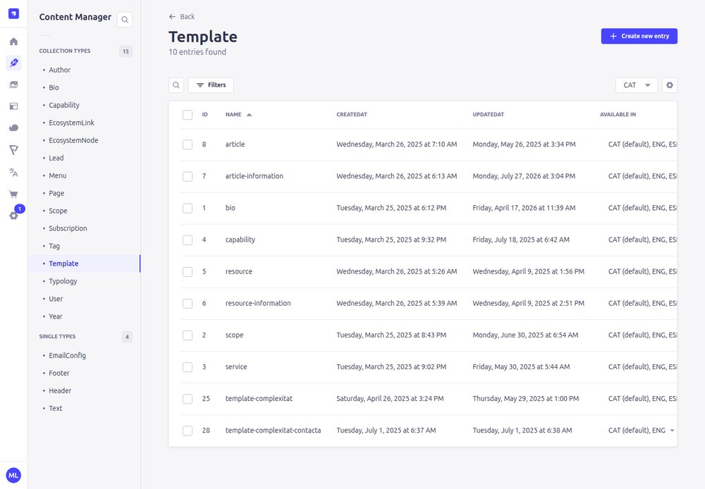
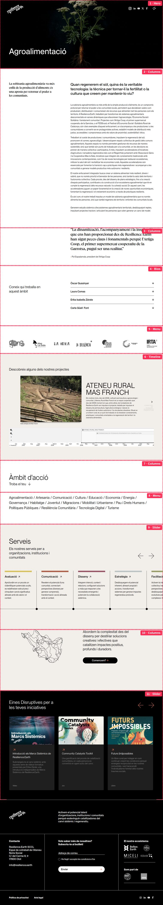

# 6. Plantilles

[← Índex](README.md)

Una **plantilla** (Content Manager → **Template**) és un grup de blocs que es reutilitza a moltes pàgines. Si canvies una plantilla, **canvia a totes les pàgines que la fan servir, a l'instant** (les plantilles no tenen esborrany: *Save* ja publica).



Hi ha tres maneres com una plantilla arriba a una pàgina:

## 1. Inserida a mà amb el bloc «Template»

A qualsevol pàgina pots afegir un bloc **Template** i triar la plantilla. Els seus blocs apareixen en aquella posició.

Exemple: la Home acaba amb el bloc Template → **template-complexitat** («Abordem la complexitat...» amb el botó «Connectem»).

| Plantilla | Contingut | On s'usa |
|---|---|---|
| `template-complexitat` | Bloc «Abordem la complexitat» amb botó i imatges | Home |
| `template-complexitat-contacta` | Variant amb enllaç a contacte | Pàgines que la insereixin |

## 2. Automàtiques per tipus de pàgina

Si existeix una plantilla que es diu **exactament igual que un tipus de pàgina**, els seus blocs s'afegeixen **al final de totes les pàgines d'aquell tipus**:

| Plantilla | S'afegeix al final de | Contingut actual |
|---|---|---|
| `article` | tots els articles | Slider «Caos Creatiu» (menú *Caos Creatiu*) |
| `resource` | tots els recursos | Slider «Eines disruptives...» (menú *Recursos per catalitzar...*) |
| `scope` | totes les pàgines d'àmbit | Títol «Àmbit d'acció», núvol d'àmbits, slider de Serveis, bloc «Abordem», slider de recursos |
| `service` | tots els serveis | Slider de Serveis i bloc «Abordem» |
| `capability` | totes les capabilitats | «Vols desenvolupar les teves capabilitats?», silueta, cel·lula, slider Caos creatiu |
| `bio` | totes les fitxes de persona (`/bio/...`) | Graella «Totes les que hi participem» — ⚠️ és una llista diferent de la de la pàgina *Qui som*: cal mantenir-les totes dues ([recepta J](03-receptes.md#j-posar-i-treure-persones-de-lequip-qui-som)) |
| `all` | **totes** les pàgines (excepte bios) | *(no existeix ara mateix)* |

Exemple: una pàgina d'àmbit. Els blocs 1–6 (fins al Timeline) són de la pàgina; els següents els afegeix automàticament la plantilla `scope`:



Per exemple, per canviar el slider que surt al final de tots els articles, edita la plantilla `article` (o, si només vols canviar quines targetes surten, el menú *Caos Creatiu*).

⚠️ **No canviïs el nom** d'aquestes plantilles: és el que fa que funcionin. I compte en crear plantilles amb aquests noms: apareixeran a moltes pàgines de cop.

## 3. Plantilles de fitxa d'informació

Les plantilles **`article-information`** i **`resource-information`** contenen una fitxa amb dues columnes (la fitxa i un espai) que la web **afegeix a l'esquerra** d'un bloc Columns de cada article/recurs:

- als **articles**: al **2n bloc** de la pàgina;
- als **recursos**: al **3r bloc**;
- només si aquest bloc és de tipus **Columns**.

Dins del text de la fitxa es poden fer servir aquests codis, que la web substitueix pels camps de la pàgina:

| Codi | Es substitueix per |
|---|---|
| `{type}` | `typology` (Article, Guia...) |
| `{scopes}` | `scopes` (àmbits), separats per comes |
| `{authors}` | `author` |
| `{year}` | `year` |
| `{tags}` | `tags` |

Si la pàgina no té el camp omplert, surt un guió «-».

Exemple (fitxa d'un article):

```
Tipologia
{type}
<hr>
Àmbits
{scopes}
<hr>
Autoria
{authors}
```

[← Estils](05-estils.md) · [Següent: Problemes freqüents →](07-problemes.md)
